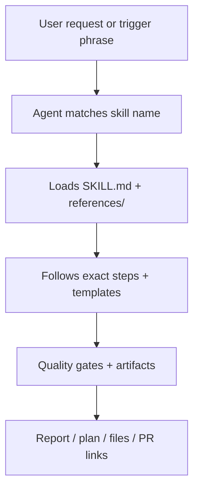

<p align="center">
  
</p>

<p align="center">
  <a href="https://opensource.org/licenses/MIT"></a>
  <a href="CONTRIBUTING.md"></a>
  <a href="https://github.com/luongnv89/skills/releases"></a>
  <a href="https://github.com/luongnv89/skills"></a>
</p>

# Install expert workflows for AI coding agents

One command drops a tested, versioned skill into your agent. No more ad-hoc prompts. The same rigorous steps run every time.

Skills are independent files. Works with Claude Code, Cursor, Windsurf, GitHub Copilot, OpenAI Codex, OpenCode, Google Antigravity (`install.sh:23`).

[**Browse catalog**](#skill-catalog) | [**Install**](#install)

---

## What's New in 6.0.0

This catalog release ships lstack and lstack-extras 0.11.0, and lstack grows to 17 skills. [readme-generator](skills/readme-generator/) 1.0.0 is a new core skill that writes or rewrites a README so a new user can act from the first screen: the project name, a one-sentence pitch, `## Install` with one command and `## Quick start` with the most common task and its expected output, in at most 30 lines. A rewrite keeps a `README.backup.md` and every original section, each command traces to a project file, and the skill never runs project code. [landing-page-generator](extras/landing-page-generator/) 2.0.0 hands README work to it: it still builds a landing page from your README, but it no longer edits `README.md` or writes `PRIVACY.md`, `TERMS.md`, `CHANGELOG.md` or `docs/getting-started.md` into the repo, which is why this release is major. [devops-pipeline](skills/devops-pipeline/) 2.6.3 generates CI that writes coverage to the GitHub Actions job summary instead of uploading it to Codecov, and drops the `id-token: write` permission, so lstack sends no credential off GitHub. Individual skills keep their own versions; the catalog release does not reset them to 6.0.0.

**Upgrading from 5.1.0:**

- **Action needed:** to write or rewrite a README, use readme-generator (`/lstack:readme-generator` for plugin users) instead of landing-page-generator, which now only reads the README as a brief. If the retired `readme-to-landing-page` skill is still installed, remove it so it does not compete for README triggers.
- Claude Code plugin users: run `claude plugin marketplace update lstack`, `claude plugin update lstack@lstack --scope user` and `claude plugin update lstack-extras@lstack --scope user`, then restart Claude Code to get 0.11.0 and readme-generator.
- ZIP and Codex users: download `lstack-0.11.0.zip`, `lstack-claude-0.11.0.zip` or `lstack-codex-0.11.0.zip` from the [v6.0.0 release](https://github.com/luongnv89/skills/releases/tag/v6.0.0) and install them as before; each holds the 17 core skills.
- `install.sh`, `remote-install.sh` and `npx skills` users: add readme-generator with `npx skills@1.7.0 add https://github.com/luongnv89/skills --skill readme-generator`, and reinstall landing-page-generator and devops-pipeline to get the updates; skills you already installed are unchanged until then.
- CI generated by an earlier devops-pipeline keeps uploading to Codecov. Regenerate it to get coverage in the job summary and drop the `id-token: write` permission.

**Earlier upgrade guidance (from 5.0.0):**

- Claude Code plugin users: run `claude plugin marketplace update lstack`, `claude plugin update lstack@lstack --scope user` and `claude plugin update lstack-extras@lstack --scope user`, then restart Claude Code to get 0.10.0.
- ZIP and Codex users: download `lstack-0.10.0.zip`, `lstack-claude-0.10.0.zip` or `lstack-codex-0.10.0.zip` from the [v5.1.0 release](https://github.com/luongnv89/skills/releases/tag/v5.1.0) and install them as before.
- `install.sh`, `remote-install.sh` and `npx skills` users: reinstall test-coverage, logo-designer, devops-pipeline and ship to get the updates; skills you already installed are unchanged until then.
- CI generated by an earlier devops-pipeline that uploads with `CODECOV_TOKEN` keeps working. Regenerate it to switch to OIDC, then you can delete the secret.

**Earlier upgrade guidance (from 4.4.0):**

- If you installed lstack as a Claude Code plugin and use any skill outside its 16-skill engineering core, such as idea-validator, product-launch or issue-work-loop, run `claude plugin marketplace update lstack` and `claude plugin update lstack@lstack --scope user`, then `claude plugin install lstack-extras@lstack --scope user` to get the 32 skills that moved. Restart Claude Code, then call them as `/lstack-extras:<skill>` instead of `/lstack:<skill>`, for example `/lstack-extras:idea-validator`.
- If you load lstack for one session with `--plugin-dir`, add a second `--plugin-dir` pointing at your checkout's `extras/` folder: `claude --plugin-dir /absolute/path/to/checkout/skills --plugin-dir /absolute/path/to/checkout/extras`.
- ZIP and Codex users: `lstack-0.9.0.zip`, `lstack-claude-0.9.0.zip` and `lstack-codex-0.9.0.zip` from the [v5.0.0 release](https://github.com/luongnv89/skills/releases/tag/v5.0.0) hold the 16 core skills. Install the other 32 with `install.sh` or `remote-install.sh` (see [Install](#install)), which still offer all 48.
- `install.sh`, `remote-install.sh` and `npx skills` users are unaffected: skills install as before, and skills you already installed are unchanged until you reinstall them.

**Earlier upgrade guidance (from 4.3.0):**

- Add the new skills: `npx skills@1.7.0 add https://github.com/luongnv89/skills --skill hc-agent --skill agent-profile`. Skills you already installed are unchanged; reinstall them to get the updates.
- If you installed lstack from this repository's marketplace, run `claude plugin marketplace update lstack`, then `claude plugin update lstack@lstack --scope user`, and restart Claude Code to get 0.8.0. ZIP users download `lstack-0.8.0.zip`, `lstack-claude-0.8.0.zip` or `lstack-codex-0.8.0.zip` from the [v4.4.0 release](https://github.com/luongnv89/skills/releases/tag/v4.4.0) and install them as before.
- Contributors: each skill's `docs/README.md`, `evals/` and `tests/` moved from `skills/<name>/` to `meta/<name>/`, mirroring the `skills/` path (suite children: `meta/<umbrella>/<child>/`), so the `skills/` plugin folder now holds 425 files, under the plugin directory's 512-file limit. Put them in `meta/<name>/`, never inside `skills/`; eval fixtures still go in `eval-fixtures/<name>/`, and `files` entries still read `../../eval-fixtures/<name>/` (see [CONTRIBUTING.md](CONTRIBUTING.md)).

**Earlier upgrade guidance (from 4.2.0):**

- Add user-test, product-launch and rex-agent: `npx skills@1.7.0 add https://github.com/luongnv89/skills --skill user-test --skill product-launch --skill rex-agent`.

**Earlier upgrade guidance (from 4.1.0):**

- Add github-pages-publish: `npx skills@1.7.0 add https://github.com/luongnv89/skills --skill github-pages-publish`.
- Contributors: put eval input fixtures in `eval-fixtures/<skill>/`, never under `skills/`, and point `evals/evals.json` `files` entries at `../../eval-fixtures/<skill>/` (see [CONTRIBUTING.md](CONTRIBUTING.md)).

**Earlier upgrade guidance (from 4.0.0):**

- If you load lstack from a clone with `--plugin-dir`, point it at the clone's `skills/` folder instead of the repository root: `claude --plugin-dir /absolute/path/to/checkout/skills`. ZIP downloads install as before.
- If you installed lstack from this repository's marketplace, run `claude plugin marketplace update lstack`, then `claude plugin update lstack@lstack --scope user`, and restart Claude Code.

**Earlier upgrade guidance (from 3.0.0):**

- Install [**ship**](meta/ship/docs/README.md): `npx skills@1.7.0 add https://github.com/luongnv89/skills --skill ship`, then replace `/release-manager` invocations with `/ship`.
- Review and remove the obsolete installed `release-manager` copy yourself; reinstalling does not remove it automatically, and both names can compete for triggers.
- `/ship [X.Y.Z|major|minor|patch]` runs autonomously by default. Use `/ship --no-auto` to keep step-by-step confirmations.

**Earlier upgrade guidance (from 2.0.0):**

- `herdr-agent-comms` is now [**herdr-agent**](extras/herdr-agent/). Reinstall under the new name and update prompts; installers do not automatically remove the old installed copy, which can still trigger.
- `plan-to-issues` moved to [luongnv89/idd](https://github.com/luongnv89/idd); see the [installation note](#product-planning). Its epic output is now a static plan map with status maintained through native GitHub sub-issues. Update parsers expecting `- [x] #N — <id>` to accept `- #N — <id>`.
- [**cleanup-project**](meta/cleanup-project/docs/README.md#migrating-from-branch-inspector) replaces `branch-inspector`. `convert-documents-to-markdown`, `fork-upstream-sync`, `opencode-sandbox`, `opencode-handoff`, `subagent-creator`, and the `website-cloner` suite are retired from this catalog. Existing installed copies are not automatically removed.

See [CHANGELOG.md](CHANGELOG.md) for the full release history.

---

## Install

> Validate this runbook: `./scripts/validate-install.sh --check`

### lstack: direct Claude Code plugin

[lstack 0.11.0](packages/lstack/README.md) is the engineering core: the `skills/` folder
holds 16 top-level definitions plus the two nested diagram-generator children, **18**
namespaced skills, all plain Markdown instructions with no helper scripts. The other 32
skills (product, marketing, App Store, design/UX, agent fleets, machine setup; 22 of them
ship helper scripts) live in `extras/` as a second plugin, **lstack-extras**, offered only
from this repository's marketplace and called as `/lstack-extras:<skill>`. The root marketplace lists both.

```bash
claude plugin marketplace add luongnv89/skills
claude plugin install lstack@lstack --scope user
claude plugin install lstack-extras@lstack --scope user   # optional
```

For one session from a trusted local checkout, run
`claude --plugin-dir /absolute/path/to/checkout/skills` (add a second
`--plugin-dir …/extras` for lstack-extras). Skills appear as
`/lstack:code-review`, `/lstack:drawio-generator`, and so on. Upgrading from lstack
0.4.0 or earlier: `--plugin-dir` now takes the checkout's `skills/` folder, not the
repository root.

Some members edit files, commit and push, install tools, call APIs or open GitHub
issues and PRs, each behind its own approval gates.
[skills/README.md](skills/README.md#what-each-skill-runs-sends-or-fetches) lists what
each skill runs, sends or fetches.

Updates, Codex builds, ZIP exports, external prerequisites and directory-portal caveats
are in the [lstack runbook](packages/lstack/README.md). Maintainers regenerate and check
the plugin metadata from `packages/lstack/manifest.json` with:

```bash
python3 scripts/build-lstack.py --write-plugin-metadata
python3 scripts/build-lstack.py --check-plugin-metadata
```

### Standalone skills (other agents or selected members)

Pick one, several, or the whole catalog:

```bash
npx skills@1.7.0 add https://github.com/luongnv89/skills --skill code-review
npx skills@1.7.0 add https://github.com/luongnv89/skills --skill code-review --skill auto-push --skill test-coverage
npx skills@1.7.0 add https://github.com/luongnv89/skills
```

### agent-skill-manager

Use [agent-skill-manager](https://github.com/luongnv89/agent-skill-manager) (`asm`) for a single TUI/CLI across agents:

```bash
npm install -g agent-skill-manager
asm install github:luongnv89/skills
```

```bash
asm search   # find by name or description
asm list     # show installed skills
```

<details>
<summary>Other install methods</summary>

**Remote (no clone)**

```bash
curl -sSL https://raw.githubusercontent.com/luongnv89/skills/main/remote-install.sh | bash
```

Non-interactive:

```bash
curl -sSL https://raw.githubusercontent.com/luongnv89/skills/main/remote-install.sh | bash -s -- \
  --skills "code-review,auto-push" --tools "Claude Code" --scope global
```

**Clone + local**

```bash
git clone https://github.com/luongnv89/skills.git
cd skills && bash install.sh
```

</details>

---

## How It Works



A skill is a self-contained playbook: frontmatter metadata, instructions, optional scripts, and reference docs. The installer copies it to the right path for your agent.

---

## Key Features

| Feature | What you get |
|---|---|
| Standalone | Any mix installs cleanly; zero shared runtime |
| Versioned | Per-skill semver + catalog release history |
| Structured | Steps, templates, checklists, self-validation |
| Tool-agnostic | Same skill works in Claude Code, Cursor, Windsurf, Codex, Copilot |
| Scannable | Tables, diagrams, short outputs |
| Suite support | Multi-phase products (e.g. diagram-generator) with independent phases |

---

## Skill Catalog

Every skill is standalone. Install one or many.

Use:

```bash
npx skills@1.7.0 add https://github.com/luongnv89/skills --skill <name>
```

### Find by Task

One skill to invoke per task. The task skills call the related skills for you. In the two
web task skills, evidence is captured once, the live scan runs at most once, overlapping checks
are skipped where the member supports skip-checks, and remaining overlaps are merged into one
row per defect.

| Task | Invoke | It runs |
|---|---|---|
| Optimize a website/app design | [**design-optimizer**](extras/design-optimizer/) | dont-make-me-think · ux-ax-review · viral-product-evaluator · website-agent-readiness, then frontend-design only if you opt in to apply fixes |
| Optimize for SEO, AI-bot or app-store search | [**search-optimizer**](extras/search-optimizer/) | Web: seo-ai-optimizer · website-agent-readiness · viral-product-evaluator. App store: aso-marketing · viral-product-evaluator |
| Take an idea to a build plan | [**product-planner**](extras/product-planner/) | idea-validator → prd-generator → (brand-name-checker) → tad-generator → tasks-generator, resuming from the furthest existing artifact |
| Review or improve code | [**code-review**](skills/code-review/) | One skill, four modes: review, perf, clean, cleanup |
| Draw a diagram | [**diagram-generator**](skills/diagram-generator/) | Routes to drawio-generator or excalidraw-generator |

These other task areas don't have a task skill. Each skill in them stands alone, so invoke them in this order:

| Task | Skills, in order |
|---|---|
| Prepare an app store submission | aso-marketing → appstore-assets → appstore-review-checker |
| Harden and ship a repo | security-setup → devops-pipeline → ship (auto-push and cleanup-project for day-to-day work) |
| Open-source a project | oss-ready → readme-generator → doc-manager → landing-page-generator → github-pages-publish |
| Brand and launch | brand-name-checker → logo-designer → landing-page-generator → github-pages-publish → product-launch |
| Run an agent fleet | herdr-agent (Herdr TUI) *or* hc-agent (Herdr desktop app) *or* rex-agent *or* tmux-agent-comms (alternative backends) · issue-work-loop (Herdr TUI or desktop app) · opencode-runner · agent-profile |

### Find by Category

| Category | What it covers |
|---|---|
| [Code Quality](#code-quality) | Reviews, cleanup, testing, optimization, usability |
| [Shipping](#shipping) | Auto push, repo cleanup, pipelines, releases, GitHub Pages publishing, security hardening |
| [Product Planning](#product-planning) | Validation, PRDs, architecture, tasks, naming, launch planning |
| [Career Research](#career-research) | Tailored job discovery with employer/product due diligence |
| [Frontend & Design](#frontend--design) | UIs, logos, diagrams, design optimization |
| [Documentation](#documentation) | Docs gen, READMEs, SEO, OSS prep, agent config |
| [App Store](#app-store) | ASO, screenshots and creative assets, review compliance |
| [Tooling](#tooling) | CLIs, installers, local models, agent comms |

### Code Quality

| Skill | Version | Effort | What it does |
|---|---|---|---|
| [**code-review**](skills/code-review/) | 2.5.0 | high | Review or improve code — 4 modes: bugs/security, performance, clean-code audit, slop cleanup |
| [**comment-audit**](skills/comment-audit/) | 1.0.0 | high | Sort every code comment as Tautology, Excuse, Stale or Decision Record; delete, file issues, write ADRs and ratchet a comment ban, each after your approval |
| [**codebase-modernizer**](extras/codebase-modernizer/) | 1.5.2 | max | Whole-repo audit + phased, testable plan to modernize a stale or messy codebase |
| [**test-coverage**](skills/test-coverage/) | 1.8.0 | low | Target untested branches and edge cases |
| [**user-test**](extras/user-test/) | 1.1.0 | high | Launch an app, API or CLI and test every feature as a real user; log bugs, perf and UX issues with evidence; fix and verify simple ones; report with a plan |
| [**dont-make-me-think**](extras/dont-make-me-think/) | 1.7.1 | medium | Usability review using Krug's principles |
| [**ux-ax-review**](extras/ux-ax-review/) | 1.3.0 | high | Evidence-backed human UX + AI/search AX audit and approval-gated improvement plan |

**`code-review` has four modes** — pick by intent or pass `mode:<name>`:

| I want to... | Mode | It... |
|---|---|---|
| Find bugs, security, or quality issues in a diff | `review` (default) | reads + reports prioritized findings |
| Make code faster / fix perf bottlenecks | `perf` | reads + reports performance fixes |
| Audit readability/standards vs the Clean Code cheat sheet | `clean` | writes an audit report (`CLEAN_CODE_AUDIT.md`) |
| Actually apply cleanup / refactor out AI slop & cruft | `cleanup` | **writes code** (8-subagent refactor) |

**`code-review` or `codebase-modernizer`?** Scope decides. `code-review` inspects a diff, a PR, or a
file set and reports findings. `codebase-modernizer` audits the *whole repo* across all ten
dimensions — including dependency and runtime currency, which nothing else here covers — and converts
the findings into a phased sprint plan with milestones. It is read-only: dependency upgrades become
planned tasks with migration steps, never a bulk `npm update`. Reach for it when returning to a
neglected project or untangling one that has drifted.

Adjacent skills: **test-coverage** (generate tests for untested branches) · **user-test** (run the app and test it as a user) · **dont-make-me-think** (usability/UX review).

### Shipping

| Skill | Version | Effort | What it does |
|---|---|---|---|
| [**auto-push**](skills/auto-push/) | 1.2.3 | low | Commit message + stage + push with secret and size checks |
| [**cleanup-project**](skills/cleanup-project/) | 1.1.1 | high | Review uncommitted changes, update ignore files, delete merged branches locally and on origin, end on clean main |
| [**devops-pipeline**](skills/devops-pipeline/) | 2.7.0 | medium | Pre-commit + lean, fast GitHub Actions quality gates, and cutting Actions minutes |
| [**github-pages-publish**](extras/github-pages-publish/) | 1.1.1 | high | Publish or update a static site on GitHub Pages via GitHub Actions in any repo; URL returned only after a live check |
| [**security-setup**](extras/security-setup/) | 1.6.3 | high | Local pre-commit secret scans, dep checks, static analysis, gated CI |
| [**ship**](skills/ship/) | 3.1.2 | max | Autonomous release: version bumped everywhere, changelog, docs and landing page, tag, GitHub release, publish |

### Product Planning

| Skill | Version | Effort | What it does |
|---|---|---|---|
| [**product-planner**](extras/product-planner/) | 1.2.1 | high | One run from idea to sprint tasks: idea-validator → prd-generator → tad-generator → tasks-generator, resuming from existing files |
| [**idea-validator**](extras/idea-validator/) | 1.11.0 | max | Market, feasibility, competitor checks for ideas |
| [**viral-product-evaluator**](extras/viral-product-evaluator/) | 1.8.3 | high | Score codebase + landing page vs 32 viral principles |
| [**product-launch**](extras/product-launch/) | 1.4.2 | high | Pick launch sites from 50 (Product Hunt, HN, Reddit, directories) for a product, then write setup guides, posts and pitches after you approve the plan; submits to Product Hunt through its MCP only after you approve the preview |
| [**brand-name-checker**](extras/brand-name-checker/) | 1.7.0 | max | Trademark, domain, social, registry conflicts |
| [**prd-generator**](extras/prd-generator/) | 1.7.0 | max | Structured PRD from idea or validate notes |
| [**tad-generator**](skills/tad-generator/) | 1.8.2 | max | Technical architecture document from PRD |
| [**tasks-generator**](extras/tasks-generator/) | 1.7.0 | max | Sprint tasks and plan from PRD |

> **`plan-to-issues` moved to [luongnv89/idd](https://github.com/luongnv89/idd)** (idd#502), next to the `issue-creator` it depends on: `asm install https://github.com/luongnv89/idd --skill plan-to-issues`, or the idd Claude Code plugin.

### Career Research

| Skill | Version | Effort | What it does |
|---|---|---|---|
| [**ai-job-scout**](extras/ai-job-scout/) | 1.2.2 | high | Rank open AI roles for a candidate; verify location and application links; assess each company's product, project, and technical interest with cited evidence; filterable HTML report for larger searches |

### Frontend & Design

| Skill | Version | Effort | What it does |
|---|---|---|---|
| [**frontend-design**](skills/frontend-design/) | 1.5.3 | high | Production UIs with usability-first approach |
| [**logo-designer**](extras/logo-designer/) | 1.6.0 | medium | 7 SVG logo variants plus PNG exports from project context |
| [**diagram-generator**](skills/diagram-generator/) | 1.5.1 | high | One entry point for diagrams — routes to draw.io XML or Excalidraw JSON |
| [**design-optimizer**](extras/design-optimizer/) | 1.2.1 | high | One run to optimize a website/app design: usability, UX/AX, virality, agent readiness, opt-in fixes |

**Diagram generator engines** (install the umbrella or a single engine):

| Engine | Version | What it does |
|---|---|---|
| drawio-generator | 1.5.2 | draw.io XML — precise, editable, C4, swimlanes |
| excalidraw-generator | 1.6.2 | Excalidraw JSON — hand-drawn, sketch, wireframes |

### Documentation

| Skill | Version | Effort | What it does |
|---|---|---|---|
| [**doc-manager**](skills/doc-manager/) | 2.2.1 | medium | Generate/update docs to match code, cited to path:line, never invented |
| [**readme-generator**](skills/readme-generator/) | 1.0.0 | high | Write or rewrite a README onboarding-first: pitch, install, the most common use with its output, then every detail |
| [**landing-page-generator**](extras/landing-page-generator/) | 2.0.0 | high | Landing pages: marketing copy from a brief or a README (read only), with privacy, terms, changelog, and docs pages, built as HTML with frontend-design |
| [**search-optimizer**](extras/search-optimizer/) | 1.2.1 | high | One run to optimize SEO, AI-bot and app-store search: web or store branch, one merged report |
| [**seo-ai-optimizer**](extras/seo-ai-optimizer/) | 1.7.2 | high | Technical SEO + AI-bot directives |
| [**website-agent-readiness**](extras/website-agent-readiness/) | 1.5.0 | high | Scan a live site for agent readiness, plan the gaps, file them as issues |
| [**oss-ready**](skills/oss-ready/) | 1.5.1 | low | Add OSS files and templates |
| [**agent-config**](skills/agent-config/) | 2.3.1 | medium | AGENTS.md by default (CLAUDE.md on request), shadow-checked and evidence-pruned |

### App Store

| Skill | Version | Effort | What it does |
|---|---|---|---|
| [**aso-marketing**](extras/aso-marketing/) | 1.6.1 | max | App Store + Google Play keyword and metadata optimization |
| [**appstore-assets**](extras/appstore-assets/) | 1.4.1 | high | Upload-ready App Store screenshots and creative assets for iPhone, iPad and Mac, including looping header and search videos, from code or a landing page |
| [**appstore-review-checker**](extras/appstore-review-checker/) | 1.7.1 | high | Pre-submission audit vs Apple guidelines |

### Tooling

| Skill | Version | Effort | What it does |
|---|---|---|---|
| [**cli-builder**](skills/cli-builder/) | 1.4.1 | high | 5-step CLI tool builder with approval gates and btop-inspired output |
| [**ollama-optimizer**](extras/ollama-optimizer/) | 1.4.1 | medium | Hardware-aware Ollama tuning |
| [**install-script-generator**](extras/install-script-generator/) | 2.4.0 | high | Cross-platform install.sh with env detection |
| [**opencode-runner**](skills/opencode-runner/) | 1.7.1 | medium | Delegate work to opencode free cloud models |
| [**agent-profile**](extras/agent-profile/) | 1.1.0 | medium | Run a task with a saved agent profile (harness, harness profile, model, thinking level) built from the CLIs installed on this machine |
| [**herdr-agent**](extras/herdr-agent/) | 3.3.2 | medium | Manage Herdr TUI agent fleets: tile panes, message/wait/read, steer, `help` |
| [**hc-agent**](extras/hc-agent/) | 1.0.0 | medium | Manage Herdr desktop app agent fleets via hc and herdr-app: split, prompt/wait/read, steer, `help` |
| [**rex-agent**](extras/rex-agent/) | 1.1.0 | medium | Manage Rex agent fleets: equal columns, prompt/wait/read via program status, steer, `help` |
| [**issue-work-loop**](extras/issue-work-loop/) | 1.10.0 | max | Resolve one GitHub issue via a Herdr (TUI or desktop app) implementer→reviewer loop until CLEAN |
| [**tmux-agent-comms**](extras/tmux-agent-comms/) | 2.5.0 | medium | Spawn, message, read CLI agents in tmux |
| [**dev-machine-setup**](extras/dev-machine-setup/) | 0.11.1 | high | Gap-driven dev machine setup/tune-up across macOS, Linux, Windows |

---

## Suite Folders

Most skills are `skills/<name>/`. Multi-phase products live under a suite folder: umbrella at `skills/<umbrella>/` + phases at `skills/<umbrella>/<phase>/`.

Current suite: [diagram-generator](skills/diagram-generator/) (draw.io + Excalidraw engines behind one router). Install the umbrella or any child. Installers discover both levels.

Task orchestrators ([design-optimizer](extras/design-optimizer/), [search-optimizer](extras/search-optimizer/), [product-planner](extras/product-planner/)) stay flat at `skills/<name>/`. Their members are ordinary top-level skills, and a member can belong to more than one task: viral-product-evaluator and website-agent-readiness serve both design and search. Each orchestrator checks for its members in a Dependency Preflight and tells you how to install any that are missing.

Mirror the layout for your own multi-skill products.

---

## Project docs

| Doc | Purpose |
|---|---|
| [CONTRIBUTING.md](CONTRIBUTING.md) | Contribute skills; structure and versioning |
| [docs/guide-building-agent-skills.md](docs/guide-building-agent-skills.md) | Authoring guide (plan → write → validate → distribute) |
| [docs/brand_kit.md](docs/brand_kit.md) | Logo files, colors, typography |
| [docs/DECISIONS.md](docs/DECISIONS.md) | Doc ambiguity resolutions |
| [docs/troubleshooting.md](docs/troubleshooting.md) | Install/setup validation fixes |
| [docs/archive/](docs/archive/) | Historical work notes (not current product docs) |
| [CHANGELOG.md](CHANGELOG.md) | Release history |
| [SECURITY.md](SECURITY.md) | Vulnerability reporting |
| [CODE_OF_CONDUCT.md](CODE_OF_CONDUCT.md) | Community standards |

## FAQ

**Do I need every skill?**  
No. Pick only what you need. All are independent.

**Which agents work?**  
Any that load external skill files. Installer tools (`install.sh:23`): Claude Code, Cursor, Windsurf, GitHub Copilot, OpenAI Codex, OpenCode, Google Antigravity.

**How do I make my own?**  
Follow [CONTRIBUTING.md](CONTRIBUTING.md), [docs/guide-building-agent-skills.md](docs/guide-building-agent-skills.md), or patterns from existing skills.

**Do skills change my runtime code?**  
No. They only guide the agent during development.

---

<details>
<summary><b>Supported Tool Paths</b> (`install.sh:218-321`)</summary>

| Tool | Global | Project |
|---|---|---|
| Claude Code | `~/.claude/skills/<skill>/` | `.claude/skills/<skill>/` |
| Cursor | `~/.agents/skills/<skill>/` + `.cursor/rules/<skill>.mdc` | same |
| Windsurf | `~/.agents/skills/<skill>/` + `.windsurf/rules/<skill>.md` | same |
| GitHub Copilot | `~/.agents/skills/<skill>/` + `.github/instructions/<skill>.instructions.md` | same |
| OpenAI Codex | `~/.agents/skills/<skill>/` + `~/.codex/AGENTS.md` | same |
| OpenCode | `~/.agents/skills/<skill>/` | same |
| Google Antigravity | `~/.agents/skills/<skill>/` | same |

</details>

<details>
<summary><b>Project Structure</b></summary>

```
.
├── skills/                  # lstack plugin: engineering skills, no code files (directory-submittable)
│   ├── <name>/
│   │   ├── SKILL.md         # Required: frontmatter + instructions
│   │   ├── references/      # Loaded on demand
│   │   └── agents/          # Optional subagent prompts
│   ├── <umbrella>/<child>/  # Suite children (install.sh discover_skills)
│   ├── README.md            # Plugin directory listing page
│   └── .claude-plugin/      # Generated plugin.json
├── extras/                  # lstack-extras plugin: the other skills, scripts allowed
│   ├── <name>/scripts/      # Optional helpers
│   ├── README.md            # Listing page and data-handling table
│   └── .claude-plugin/      # Hand-written plugin.json
├── meta/<name>/             # Non-runtime files, kept out of the 512-file plugin folder
│   ├── docs/README.md       # Human-facing docs
│   ├── evals/evals.json     # Trigger/behavior suites
│   └── tests/               # Tests for the skill's scripts
├── eval-fixtures/<name>/    # Eval input fixtures
├── packages/lstack/         # lstack manifest + runbook
├── scripts/                 # Build, validation and eval runners
├── tests/                   # lstack packaging tests
├── docs/                    # GitHub Pages site, guides, brand assets
├── examples/                # Worked examples (logo-designer case study)
├── .claude-plugin/          # Root marketplace.json
├── .claude/agents/          # Maintainer subagents for this repo
└── install.sh / remote-install.sh
```
</details>

<details>
<summary><b>Acknowledgements</b></summary>

- frontend-design draws from Anthropic's patterns.
- Many skills follow the conventions established in the skill-creator lineage.
</details>

---

<p align="center">
  <a href="https://luongnv.com">Website</a> ·
  <a href="https://github.com/luongnv89/claude-howto">Claude How-To</a> ·
  <a href="https://medium.com/@luongnv89">Blog</a>
</p>
