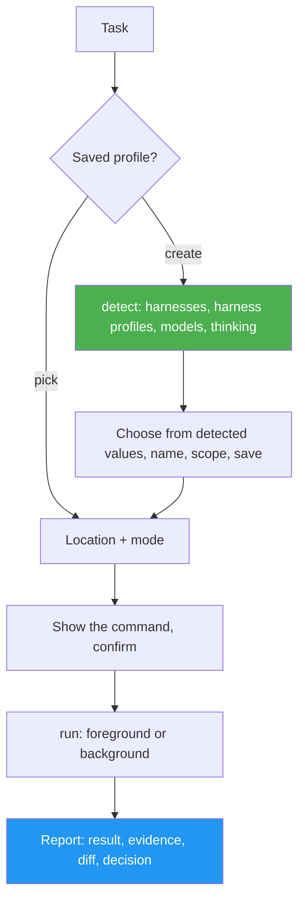

<!--
  DO NOT READ THIS FILE — This README.md is for human catalog browsing only.
  It ships inside the .skill package but is NEVER auto-loaded into agent context.
  The runtime loader only reads SKILL.md + references/ + scripts/ + agents/ when the skill triggers.
  If you're an AI agent, read the SKILL.md file instead for skill instructions.
-->
# Agent Profile

> Hand one task to another coding agent through a named profile: harness + harness profile + model + thinking level + permissions. Every option comes from what is installed on this machine.

## Highlights

- **Discovery first.** `detect` finds the installed harness CLIs and their versions, then each one's harness profiles (mcc profiles for Claude Code, Codex config profiles), its models (`pi --list-models`, `opencode models`, `devin models list`, Claude Code's aliases) and its thinking levels (parsed from each CLI's `--help`). New profiles offer only what it found.
- **Reusable profiles**, stored globally (`~/.config/agent-profile/profiles.json`) or per project (`.agent-profiles.json`, which overrides a global profile of the same name). No credentials are ever stored.
- **Each run asks** where it goes (current directory or a new git worktree) and how (foreground or background), and shows the exact command first. Every full-permissions run needs its own yes. pi and opencode run with full tool access only, because neither can restrict its tools headless.
- **Safe launch.** The task reaches the harness as a file or a single argument, never through a shell. Each run leaves a run folder with the prompt, the command, the log and the result (done, failed, timeout, interrupted, stopped). `status` and `stop` follow background runs.
- **Eight adapters.** Claude Code (with mcc), pi and opencode are verified by real runs. Codex, Factory Droid, Devin CLI, Grok Build and Gemini CLI follow their docs, and their flags are checked against `--help` before each run.

## When to Use

| Say this... | Skill will... |
| --- | --- |
| "/agent-profile" | List saved profiles plus "Create a new profile", then ask for the task, location and mode |
| "/agent-profile cc-sonnet write tests for dates.py" | Run that task with the saved profile, after showing the command |
| "Make a pi profile with the highest thinking level" | Detect pi's models and levels, then save the profile |
| "Run this in a worktree in the background with pi-max" | Create an `agent/…` worktree, start the run, return the run folder |

## How It Works



## Usage

```
/agent-profile [profile-name] [task]
```

Needs Python 3.9+ (3.11+ to read Codex profiles), git, and at least one logged-in harness CLI.

## Resources

| Path | Description |
| --- | --- |
| `scripts/agent_profile.py` | `detect`, `list`, `show`, `save`, `delete`, `command`, `run`, `status`, `stop` (standard library only) |
| `references/harnesses.md` | Per-harness detection, models, thinking, permission flags, headless command, verified/untested status |
| `references/profile-format.md` | Storage, profile fields, run folder, error messages, edge cases |

## Output

A saved profile, and for each run a folder `~/.cache/agent-profile/runs/<stamp>-<profile>/` holding `prompt.md`, `command.json`, `output.log` and `result.json`. The chat report gives the result, the evidence (exit code, duration, files changed), what is unverified, and the decision left to you. The skill never commits, merges or pushes.
