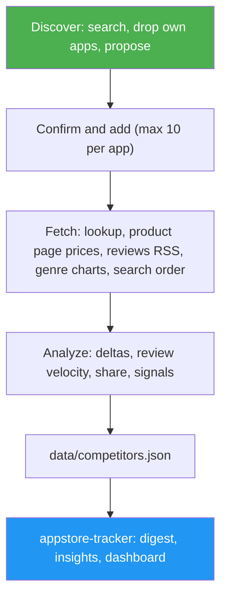

<!--
  DO NOT READ THIS FILE — This README.md is for human catalog browsing only.
  It ships inside the .skill package but is NEVER auto-loaded into agent context.
  The runtime loader only reads SKILL.md + references/ + scripts/ + agents/ when the skill triggers.
  If you're an AI agent, read the SKILL.md file instead for skill instructions.
-->
# App Store Competitor Tracker

> See how each of your apps' competitors is growing and what they charge, from public App Store data: new ratings, review velocity, releases, upfront and in-app prices, genre chart rank and search position. No account or key needed.

## Highlights

- Proposes competitors for each of your apps from App Store search (relevant ones first, your own apps dropped) and tracks only the ones you confirm, up to 10 per app.
- Keeps one public snapshot per day under `<data dir>/competitors/`: lookup (ratings, version, price), each app's product page (upfront price and up to 10 in-app purchases with their prices), the customer-review RSS feed, the genre top free and paid charts (iOS) and your search terms' result order.
- Compares pricing: each app's model (paid, free + in-app, free), entry price, cheapest and dearest in-app purchase, and heuristic tiers (weekly, monthly, yearly, lifetime, remove-ads), against the competitors' median in the same storefront.
- Computes Δ ratings over 7 and 28 days (after a 7-day baseline), written reviews in 7/28/90 days from the first run, each app's share of the group's new reviews, version age, price changes, chart and search movement.
- Emits rule-based signals (`competitor_outpacing`, releases, price and in-app price changes, pricing gap, missing offers such as lifetime or remove-ads, rank gains, search gaps, rating gap) under your app's id, so `appstore-tracker` cites them in its actions and shows a Competitors section in every app view of its dashboard.
- Never presents a proxy as downloads or revenue; failed sources are gaps, never zeros.

## When to Use

| Say this... | Skill will... |
| --- | --- |
| "How are my competitors doing?" | Fetch today's snapshot, analyze, and report who grows fastest per app, with the proxy named |
| "Find competitors for my app 123456789" | Search the store and propose candidates; add only the ones you confirm |
| "Track Bear and Craft against my notes app" | Add them to the app's group with your search terms |
| "Why did my search rank drop?" | Compare your position with competitors' for each tracked term |
| "What do my competitors charge?" | List each competitor's model, entry price and in-app purchases, and flag where your pricing stands apart |

## How It Works



## Usage

```
/appstore-competitor-tracker
```

Runs on its own with Python 3.9+ and network access to `itunes.apple.com` and `apps.apple.com`. With `appstore-tracker` installed, its daily report runs the competitor step for you and adds a Competitors section and a Competitive position card to the dashboard.

## Resources

| Path | Description |
| --- | --- |
| `scripts/competitors.py` | `discover`, `add`, `remove`, `config`, `status`, `fetch`, `analyze`, `demo` (standard library only) |
| `references/competitor-playbook.md` | Sources, metric definitions, caveats, signal catalog with thresholds, signal → action table |

## Output

`<data dir>/data/competitors.json` with per-app groups (your app plus each competitor), metrics and signals, plus the snapshot history and merged reviews under `<data dir>/competitors/`. The chat answer gives one line per app on who grows fastest, the evidence, up to three actions citing signal ids, and the gaps (baseline days, capped review counts, failed sources).
