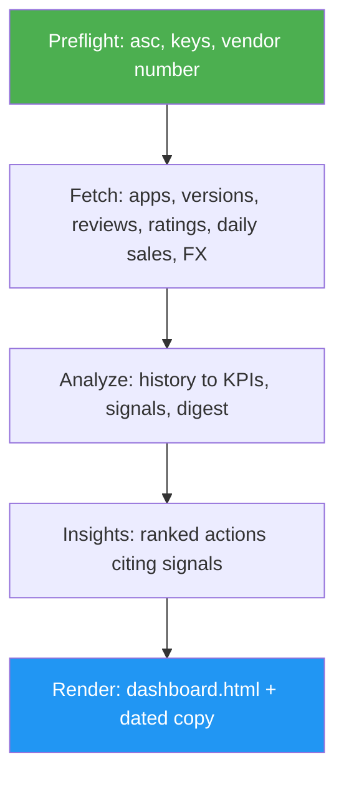

<!--
  DO NOT READ THIS FILE — This README.md is for human catalog browsing only.
  It ships inside the .skill package but is NEVER auto-loaded into agent context.
  The runtime loader only reads SKILL.md + references/ + scripts/ + agents/ when the skill triggers.
  If you're an AI agent, read the SKILL.md file instead for skill instructions.
-->
# App Store Tracker

> Track every app in your App Store Connect account: daily sales, downloads, proceeds, reviews and ratings, with trend insights, ranked actions and a dated HTML dashboard.

## Highlights

- Collects apps, versions, customer reviews, public ratings, store listings, in-app product states, App Analytics (downloads, proceeds, impressions, product page views) and daily Sales and Trends reports through the `asc` CLI, always read-only.
- Keeps a day-by-day history in `~/.appstore-tracker`: it backfills up to a year of daily sales reports, then downloads only the missing days.
- Computes rule-based signals (trends, spikes, release impact, store funnel and conversion, refunds, localization gaps, unanswered negative reviews, unsellable products, rejected apps with their App Review guideline), and the agent turns them into ranked actions that cite their evidence. A 4.3 spam rejection is never answered with "resubmit".
- Writes one self-contained `dashboard.html` (portfolio view plus one view per app, light and dark, no CDN) and a dated copy for every run.
- Drafts replies to unanswered negative reviews. It never posts them.
- With [appstore-competitor-tracker](../../appstore-competitor-tracker/docs/README.md) installed, each report also shows how every app's competitors grow (new ratings, written reviews, chart and search rank, never their downloads or revenue): competitor signals in the actions, a Competitors section per app (with each app's pricing model, entry price and in-app purchase list) and a Competitive position card.

## When to Use

| Say this... | Skill will... |
| --- | --- |
| "How are my App Store apps doing?" | Refresh all data, write insights and actions, render the dashboard |
| "How is TextWiz doing on the App Store?" | Run the same pipeline and answer for that app, with a link to its view |
| "Just refresh my app store stats" | Update the data and the dashboard without new recommendations |
| "How are my competitors doing?" | Fetch competitor snapshots, merge their signals, and add one Competitors line per app |
| "Show me what the tracker would look like" | Build a dashboard from synthetic demo data in a separate folder |

## How It Works



## Usage

```
/appstore-tracker
```

Needs the `asc` CLI (`brew install asc`) signed in with an App Store Connect API key. Downloads, proceeds and the store funnel come from App Analytics through an `asc web` session you create yourself (`asc web auth login`). Daily Sales reports add country, device, refund and product detail and need a key with the Sales, Finance or Admin role plus your vendor number. Without either, the dashboard still covers reviews, ratings, versions and listing status, and says what is missing.

## Resources

| Path | Description |
| --- | --- |
| `scripts/tracker.py` | `status`, `config`, `fetch`, `analyze`, `render` and `demo` subcommands (Python standard library only) |
| `assets/dashboard.html` | The dashboard template: inline SVG charts, filters, reviews browser, daily log |
| `references/analysis-playbook.md` | Metric definitions, data caveats, signal catalog, action playbook, insights schema |

## Output

`~/.appstore-tracker/dashboard.html` (the latest) and `history/<date>.html` (one per day; a numbers-only refresh keeps that day's report), built from the raw reports, snapshots and insights kept beside them. The chat answer gives the headline, the key numbers, the ranked actions and the data gaps. The files hold private sales data and reviews: keep them local.
