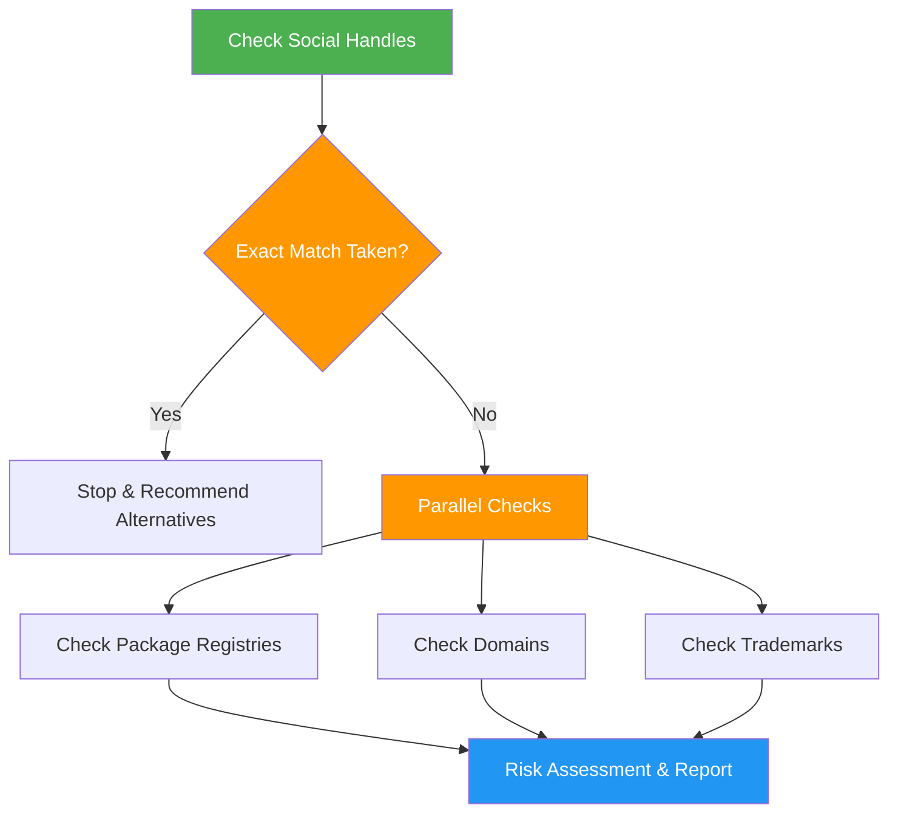

<!--
  DO NOT READ THIS FILE — This README.md is for human catalog browsing only.
  It ships inside the .skill package but is NEVER auto-loaded into agent context.
  The runtime loader only reads SKILL.md + references/ + scripts/ + agents/ when the skill triggers.
  If you're an AI agent, read the SKILL.md file instead for skill instructions.
-->

# Brand Name Checker

> Check product and brand names for social media, package registry, domain, and trademark conflicts with risk assessment.

## Highlights

- **Parallel subagents**: one source-checker per check (social, registries, domains, trademarks), the last three in parallel, then a synthesizer
- Priority-based checking: social handles, package registries, domains, then trademarks
- Package registry checks: npm, PyPI, Homebrew, apt — prevent namespace squatting
- Critical stop rule if exact social handle is already taken
- Risk assessment with Low, Moderate, or High conflict rating
- Generate alternative name suggestions with registration order (registries first)

## When to Use

| Say this... | Skill will... |
|---|---|
| "Check this name" | Run full availability check |
| "Is this name available?" | Check social, registries, domain, and trademark |
| "Is this package name taken on npm/PyPI?" | Check package registry availability |
| "Validate a product name" | Assess risk and suggest alternatives |
| "Can I publish under this name?" | Check all registries and suggest variants |

## How It Works



## Installation

Install via [npx (Vercel)](https://www.npmjs.com/package/skills):

```bash
npx skills@1.7.0 add https://github.com/luongnv89/skills --skill brand-name-checker
```

Or via [agent-skill-manager (asm)](https://www.npmjs.com/package/agent-skill-manager):

```bash
asm install github:luongnv89/skills:extras/brand-name-checker
```

## Usage

```
/brand-name-checker <name>
/brand-name-checker <name1>, <name2>
```

Several names get one full report each, plus a quick-screen table for the suggested alternatives. The table is partial and unverified: it never clears a name.

## Resources

| Path | Description |
|---|---|
| `agents/source-checker.md` | Run one check (social platforms, package registries, domains, or trademark databases) from `references/source-checks.md` and return a status and evidence per source |
| `agents/synthesizer.md` | Apply the SKILL.md risk policy and produce the final recommendation with alternatives |
| `references/source-checks.md` | The single home of the per-source queries, check URLs, and status rules for the social, registry, domain, and trademark checks |
| `references/output-contract.md` | Report field rules, status words, understanding criteria, and three worked examples |
| `references/edge-cases.md` | Handling for rate limits, source outages, special characters, very short names, and typosquats |
| `references/prd-integration.md` | Name Fit Assessment and Alternative Suggestions appended when `prd.md` exists |
| `references/step-reports.md` | Step Completion Report templates for each of the 6 steps |
| `references/repo-sync.md` | Stash-first sync snippet for runs that write files in a repository |
| `evals/evals.json` | 8 eval cases: 3 happy-path, 3 edge, 2 negative-trigger |
| `tests/test_risk_policy.py` | Static contract tests that pin the risk policy wording |

## Output

A compact text report. The first line, `RESULT:`, gives the status (COMPLETE, PARTIAL when any check could not be verified, or BLOCKED when no name was given or no web access works) and how many of the checks (16 by default) were verified. Then come one status per source for social media (6 platforms), package registries (npm, PyPI, Homebrew, apt), domains (.com, .io, .app, plus one check for each extra TLD that `prd.md` or you name), and trademark databases (WIPO, EUIPO, INPI), the evidence behind each status, skipped and unknown checks, the risk level with its triggering finding, and a Proceed/Modify/Abandon recommendation that ends with your next decision. A Proceed result suggests registration order: registries first, to prevent namespace squatting.
