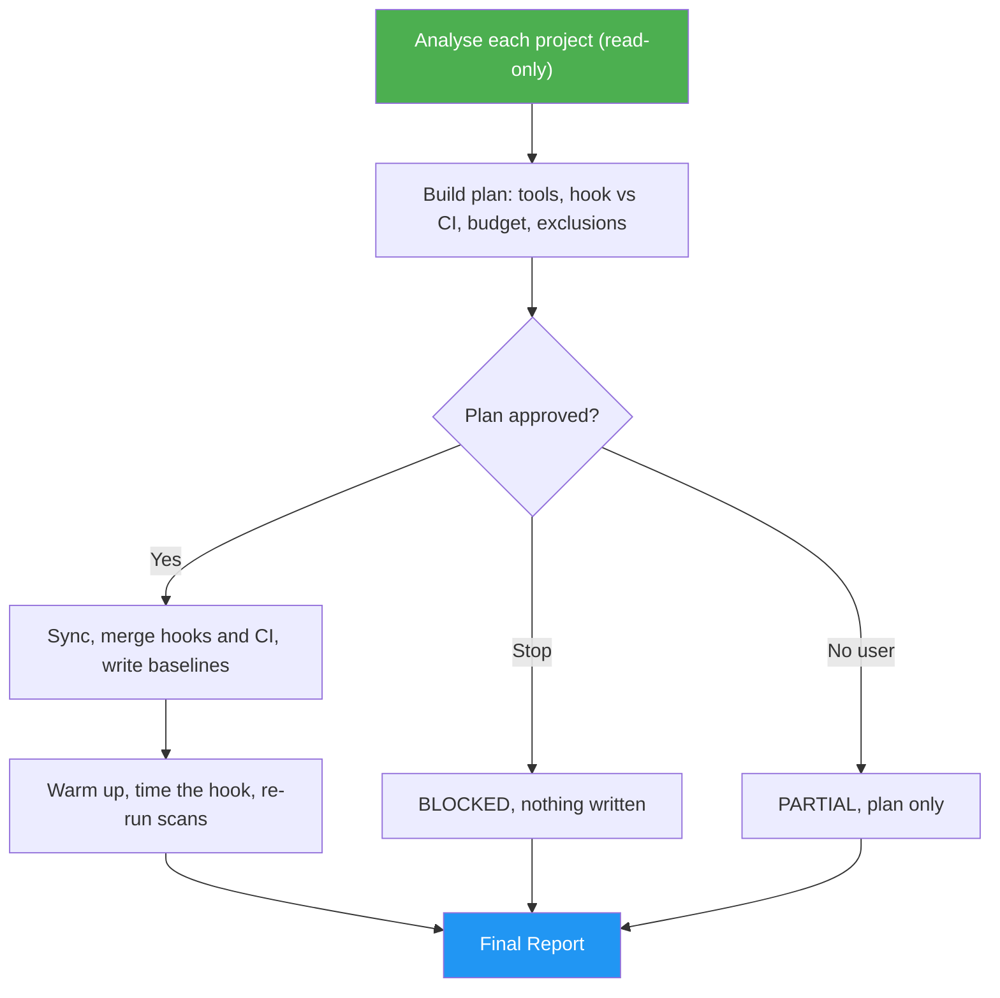

<!--
  DO NOT READ THIS FILE — This README.md is for human catalog browsing only.
  It ships inside the .skill package but is NEVER auto-loaded into agent context.
  The runtime loader only reads SKILL.md + references/ + scripts/ + agents/ when the skill triggers.
  If you're an AI agent, read the SKILL.md file instead for skill instructions.
-->

# Code Analysis Setup

> Plan a free static-analysis layer for one or more projects (linters, SAST, secret scanning, dependency scanning), then install it only after you approve. Fast checks go in your existing pre-commit hook within a time budget, full scans go in CI, and nothing already configured is added twice.

## Installation

Install via [npx (Vercel)](https://www.npmjs.com/package/skills):

```bash
npx skills@1.7.0 add https://github.com/luongnv89/skills --skill code-analysis-setup
```

Or via [agent-skill-manager (asm)](https://www.npmjs.com/package/agent-skill-manager):

```bash
asm install github:luongnv89/skills:skills/code-analysis-setup
```

## Usage

Run it with one or more project folders:

```
/code-analysis-setup ~/work/api ~/work/web
```

It reads each project, builds one plan, and stops for your approval:

```text
◆ code-analysis-setup plan · 2 projects · hook budget 10 s per commit
P1 api  (toplevel) · Python 88% · pre-commit · 3 files per commit
  Sync (after approval): S1 git fetch origin && git pull --rebase origin main
  Hook (append to .pre-commit-config.yaml): H1 bandit · H2 gitleaks   ruff: already configured, skipped
  CI (create .github/workflows/code-analysis.yml): J1 semgrep · J2 gitleaks history · J3 osv-scanner weekly
  Baselines: B1 .gitleaksignore (fingerprints only, values REDACTED)
  Expected hook time: ~1.2 s per typical commit
Left out: CodeQL (private repo, needs paid GitHub Advanced Security) · Bearer (not open source, off by default)
Verification: pre-commit install-hooks (setup), then pre-commit run --files <3 clean files>
Nothing has been written. Reply: approve all · approve <IDs> · change … · stop
```

## Highlights

- **Plan first, nothing written before your yes:** analysis is read-only; no stash, fetch, install or hook run before you approve. A rejected plan leaves the repo exactly as it was
- **Merges, never replaces:** new entries are appended to pre-commit, husky, lefthook and GitHub Actions; a tool already configured (including security-setup's runner) is skipped with the reason
- **Hook within a budget:** staged files only, cached, check mode; slow and whole-repo scans move to CI or a weekly schedule
- **Free and open source only:** no paid services, no logins beyond `GITHUB_TOKEN`. Bearer is offered only for apps handling personal data and labelled as not open source; CodeQL only for public repos
- **Day one does not block:** baselines for existing findings, with secrets stored as fingerprints or hashes only. A real secret is reported to rotate, never baselined silently
- **Measured, not guessed:** tools are warmed up first, then the per-commit run is timed on clean files while the index and working tree are checked unchanged

## When to Use

| Say this... | Skill will... |
|---|---|
| "Set up linting and security scanning for these repos" | Analyse every project, plan one layer, install after approval |
| "Add static analysis to our pre-commit hook without slowing commits" | Plan within the hook budget you name, CI for the rest |
| "What analyzers should this project run?" | Print the plan only |

Not for: installing the one-repo security stack (`security-setup`), building or speeding up CI/CD pipelines (`devops-pipeline`), manual code review (`code-review`).

## How It Works



## Resources

| Path | Description |
|---|---|
| `references/project-analysis.md` | Read-only detection: git toplevel, languages, hook manager, CI, configured analyzers, history metrics, monorepo signals |
| `references/tool-catalog.md` | Free tools per language and category with licence, file-list and cache support, cost and placement |
| `references/plan-template.md` | The plan format, step reports and Final Report examples |
| `references/merge-and-baseline.md` | Merge and dedup rules per hook manager and GitHub Actions, baselines, timing mechanics |

## Output

- Appended hook entries and a new `.github/workflows/code-analysis.yml` per approved project, with baseline files where needed
- Setup time and per-commit hook time against the budget
- A Final Report: `Result` (COMPLETE / PARTIAL / BLOCKED), `Evidence`, `Uncertainty`, `Decision`
- Nothing committed or pushed unless you ask
