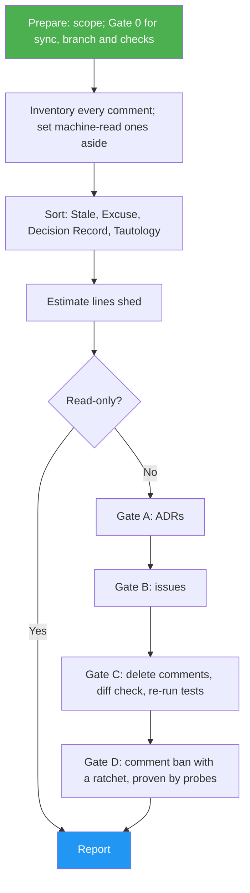

<!--
  DO NOT READ THIS FILE — This README.md is for human catalog browsing only.
  It ships inside the .skill package but is NEVER auto-loaded into agent context.
  The runtime loader only reads SKILL.md + references/ + scripts/ + agents/ when the skill triggers.
  If you're an AI agent, read the SKILL.md file instead for skill instructions.
-->

# Comment Audit

> Sort every code comment in a codebase, or one part of it, as Tautology, Excuse, Stale or Decision Record. Then act on each kind, ban new comments with a ratchet, and estimate the lines you shed. Every change waits for your approval of a plan.

## Installation

Install via [npx (Vercel)](https://www.npmjs.com/package/skills):

```bash
npx skills@1.7.0 add https://github.com/luongnv89/skills --skill comment-audit
```

Or via [agent-skill-manager (asm)](https://www.npmjs.com/package/agent-skill-manager):

```bash
asm install github:luongnv89/skills:skills/comment-audit
```

## Usage

Run it in the repository, optionally naming a folder:

```
/comment-audit src/billing/
```

It reads and sorts every comment, then stops at the first plan and waits for you:

```text
Gate A — Decision Records → ADRs (2 items)
Scope: src/billing/ · base 3f2a9c1 · branch chore/comment-audit
Changes: docs/adr/0007-round-half-even.md, docs/adr/0008-invoice-ids.md, nothing else
Items:
  ADR-0007 "Round money half-even" ← C012, C044: the ledger and the tax export must agree to the cent
  ADR-0008 "Invoice ids are never reused" ← C090: auditors match ids across years
Reply: approve all · approve <IDs> · skip · stop
```

## Highlights

- **Four kinds, one action each:**
  - Tautology and Stale comments are deleted. A doc comment that only describes what something is or does counts as a Tautology; only reasons go into ADRs.
  - Excuse comments become an issue for the hack, then are deleted.
  - Decision Records move into an ADR, then are deleted.
- **A plan before every change:** preparing the repo (pull, branch, running your checks), ADRs, issues, deletions and the lint ratchet each get their own plan. Approve all of it, some IDs, skip it, or stop. Nothing changes, not even a branch, without a reply to that plan
- **Nothing lost:** an Excuse comment is deleted only after its issue exists, and a Decision Record only after its ADR exists
- **Safe deletions:** directives, license headers, doctests, `// falls through` and other machine-read comments are never touched. A diff check allows only the approved comment lines to go, your uncommitted work is never edited or committed, and your checks must still pass with no fewer tests passed. If your checks cannot run on the machine, the plan says so before you approve
- **A ratchet, not a big bang:** existing comments go into a baseline and each file's count may only go down. It uses ESLint's bulk suppressions for JS/TS, and a small check script for other stacks
- **Two numbers:** the lines you would shed by deleting every comment, and the comment lines this run actually removed

## When to Use

| Say this... | Skill will... |
|---|---|
| "Audit every comment in this repo" | **Full**: sort, then ADRs, issues, deletions and the ratchet, each after your approval |
| "Clean up the comments in src/payments/ and stop new ones" | **Full**, with the scope set to that folder |
| "How many lines would we save by deleting all comments?" | **Read-only**: sort and estimate, no changes |

It does not write docs or docstrings, and it is not the quick slop pass inside a wider cleanup: use `code-review` in cleanup mode for that.

## How It Works



## Resources

| Path | Description |
|---|---|
| `references/categories.md` | The four kinds: signals, the sorting order, tie rules, unsure entries, examples |
| `references/comment-syntax.md` | How to find comments per language, comment units, the machine-read list, files left out |
| `references/plans.md` | The plan shown at each gate and how replies are handled |
| `references/deletion.md` | How comments are deleted, the deletion check, re-running checks, unverified deletions, commits |
| `references/adr-and-issues.md` | ADR folder and format detection, the default ADR template, issue search, body and labels |
| `references/lint-ratchet.md` | The ESLint route, the check script for other stacks, wiring, and the probes that prove it |
| `references/step-reports.md` | The step completion report format and per-step checks |
| `references/final-report.md` | The Final Report status rules, examples, and reader checks |

## Output

- An audit file outside the repository listing every comment, its kind and the reason
- ADR files, issues, comment deletions and a comment ban with its baseline, each only after you approve its plan
- One local commit each for the ADRs, the deletions and the ratchet, holding only the files that plan named. Nothing is pushed unless you ask
- A Final Report: `Result` (COMPLETE / PARTIAL / BLOCKED), `Evidence`, `Uncertainty`, `Decision`
