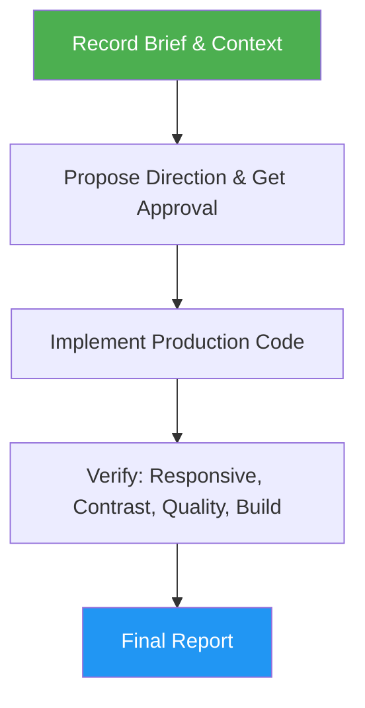

<!--
  DO NOT READ THIS FILE — This README.md is for human catalog browsing only.
  It ships inside the .skill package but is NEVER auto-loaded into agent context.
  The runtime loader only reads SKILL.md + references/ + scripts/ + agents/ when the skill triggers.
  If you're an AI agent, read the SKILL.md file instead for skill instructions.
-->

# Frontend Design

> Create distinctive, production-grade frontend interfaces with high design quality and a consistent default style guide.

## Highlights

- Bold aesthetic direction with intentional design choices, not generic AI output
- Built-in usability principles from "Don't Make Me Think" (scan-friendly, self-evident, low cognitive load)
- Default style guide (Black/White/Gray/Bright Green) when no preference is provided
- No AI-default look without a brief: a ban table with one reason per row (no gradients, glow, grain, staggered reveals, bounce, nested cards, eyebrow labels, Title Case), semantic color tokens, and motion under 300 ms with reduced motion honoured; an explicit brief can still ask for any banned element
- Reads and follows a project design-rules file (`DESIGN.md` and similar), and only proposes new rule lines
- Default quality bar: every final design is production-ready without being asked, checked row by row against the ban table and on phone and desktop screenshots
- Supports HTML/CSS/JS, React, Vue, and any modern frontend framework

## When to Use

| Say this... | Skill will... |
|---|---|
| "Build a landing page" | Design and implement a distinctive landing page |
| "Create a dashboard" | Build a polished dashboard with depth and hierarchy |
| "Design a form component" | Generate a styled, accessible form with visual flair |
| "Make a portfolio page" | Create a memorable portfolio with bold aesthetics |

## How It Works



## Installation

Install via [npx (Vercel)](https://www.npmjs.com/package/skills):

```bash
npx skills@1.7.0 add https://github.com/luongnv89/skills --skill frontend-design
```

Or via [agent-skill-manager (asm)](https://www.npmjs.com/package/agent-skill-manager):

```bash
asm install github:luongnv89/skills:skills/frontend-design
```

## Usage

```
/frontend-design
```

## Resources

| Path | Description |
|---|---|
| `references/aesthetics-guide.md` | Typography, color, motion, composition and background guidance, plus the ban table under *Avoid* |
| `references/system-defaults.md` | Design-rules file protocol, semantic tokens, motion numbers, vague-word map, subtraction pass and visual check |
| `references/usability-guide.md` | Six "Don't Make Me Think" Quick rules applied to every design, plus the Quick Reference Checklist |
| `references/step-reports.md` | Step-completion report template, symbol legend, and per-phase checks |
| `references/final-report.md` | Final Report status rules, PARTIAL and BLOCKED examples, fill rules, and reader checks |
| `meta/frontend-design/evals/evals.json` (repo root) | Trigger and behavior evals: 4 happy-path, 6 edge, 2 negative-trigger |
| `eval-fixtures/frontend-design/vue-repo/` (repo root) | Small Vue fixture for the framework-mismatch eval |
| `eval-fixtures/frontend-design/rules-repo/` (repo root) | Page with a `DESIGN.md` rules file for the rules-file eval |

## Output

Production-ready frontend code (HTML/CSS/JS or framework components) with distinctive typography, color declared as semantic tokens, motion only on state changes, and shadows only on floating elements. No code is written until you approve the aesthetic direction (or say "just build it").

Every run ends with a four-line Final Report: `Result:` (COMPLETE, PARTIAL or BLOCKED, and the files written), `Evidence:` (the visual, contrast, quality and build checks that ran), `Uncertainty:` (checks that could not run and assumptions), and `Decision:` (what you need to do next, or "No approval needed").

## Acknowledgement

Inspired by Anthropic's official [frontend-design](https://github.com/anthropics/claude-code/tree/main/plugins/frontend-design) skill. This skill is an independent implementation with a default style guide, usability principles from "Don't Make Me Think", and adaptations for this skill collection.
