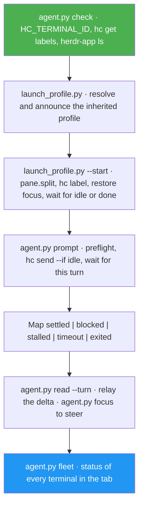

<!--
  DO NOT READ THIS FILE — This README.md is for human catalog browsing only.
  It ships inside the .skill package but is NEVER auto-loaded into agent context.
  The runtime loader only reads SKILL.md + references/ + scripts/ + agents/ when the skill triggers.
  If you're an AI agent, read the SKILL.md file instead for skill instructions.
-->

# hc Agent

> Manage AI agent fleets in the Herdr desktop app: split workers beside your agent's pane, start them on your own harness and model, prompt, wait for, read, and monitor them through the status each agent reports to `hc`, and steer any pane — without ever touching the Herdr TUI's `herdr` CLI.

## Highlights

- **Built for the app, not the TUI** — the desktop app's terminals have `HC_TERMINAL_ID`, not `HERDR_ENV`, and the `herdr` CLI there reaches a different server. hc-agent uses only `hc` (herdr-core) and `herdr-app`; herdr-agent now sends app users here.
- **One-call spawn** — `launch_profile.py --start` splits an explicit pane to the right with `herdr-app do pane.split`, labels the new terminal, puts focus back where you were, and returns only when the worker reports `idle` or `done`.
- **Workers mirror the main agent** — same harness, model, thinking level, setup flags, and launch wrapper (such as `mcc run --`) as the agent running the skill. Your own prompt is never handed to them, and an inherited permission bypass is announced first.
- **Prompt and wait in one call** — `agent.py prompt` refuses busy, blocked, silent or agent-less targets before typing, sends with `hc send --if idle`, and waits for the turn it caused; `read --turn` returns exactly that turn's reply.
- **Status you can trust** — a terminal with no OSC 7501 status is unverifiable, never idle.
- **Monitor, broadcast, dispatch, steer, tear down** — one fleet table for your tab, one task to many or one task each, `agent.focus` for the pane that needs you, and a teardown that only closes workers it started.
- **Context handoff** — when the orchestrator's own context passes 50%, it starts a successor pane, hands over a compact brief, and goes read-only.
- **Built-in `help`** — `/hc-agent help` runs no command, so it answers even before the app is installed.

## When to Use

| Say this... | Skill will... |
|---|---|
| "Spin up 2 agents beside me: reviewer and tests" (in the Herdr app) | Split two panes to the right in your tab, running your own harness, model, and thinking level |
| "Add a codex agent for a second opinion" | Start a Codex worker; your model, effort, flags, and wrapper are not carried into a different CLI |
| "Ask the reviewer what it found" | Resolve the worker, prompt it, wait for its turn, and relay the reply |
| "Broadcast 'pull main' to all my agents" | Prompt every safe worker concurrently and report each outcome |
| "What are my agents doing?" | One table of every terminal in your tab, blocked first |
| "What's different from herdr-agent?" | Answer from the operation-by-operation table, without running anything |

## How It Works



## Usage

```
/hc-agent
```

Not sure what to ask for? Start with the built-in summary:

```
/hc-agent help
```

## Popular Use Cases

### 1. Root + workers (default)

```
/hc-agent spin up 2 agents beside my pane:
- reviewer — review the last commit
- tests — propose a minimal test plan, thinking low
```

### 2. Message a running agent

```
/hc-agent ask reviewer to summarize open risks; show me the reply
```

### 3. Steer live

```
/hc-agent show me the tests agent so I can type into it
```

## Resources

| Path | Description |
|---|---|
| `references/` | App vs TUI comparison, spawn and teardown recipes, launch-profile inheritance, the status table and prompt contract, context handoff, the help text, and the final-report format |
| `scripts/` | `agent.py` (check, get, prompt, wait, read, fleet, broadcast, dispatch, focus, close), `launch_profile.py` (inherited profile and `--start`), `hclib.py` (shared helpers) |
| `meta/hc-agent/tests/` | Unit tests against fake `hc` and `herdr-app` CLIs built from captured output, in a sandboxed environment that can never reach a live app: `python3 -m unittest discover -s meta/hc-agent/tests -p 'test_*.py'` |

## Output

No files. Each fleet operation ends with a step completion report, then a final report: `Result:` first (`COMPLETE`, `PARTIAL` or `BLOCKED`), then `Evidence:` from the commands that ran, `Uncertainty:` (for example an `UNKNOWN` model, a kept wrapper, or an unchecked reply), and `Decision:` naming any approval you need to give. A `help` request prints only the usage summary.

## Requirements

- The Herdr desktop app with its `hc` and `herdr-app` CLIs on PATH (observed with hc 0.1.20 and Herdr.app 0.1.15 on macOS, including one end-to-end run with a Claude Code worker through the `mcc run --` wrapper; `references/app-vs-tui.md` lists what that run covered and what is still unverified)
- Run the orchestrator **inside** one of the app's terminals, shown in the window, so `HC_TERMINAL_ID` names it
- Worker CLIs that report OSC 7501 status (Claude Code does)

## Related

- Sibling skills: `herdr-agent` (Herdr TUI), `rex-agent` (Rex), `tmux-agent-comms` (plain tmux)
