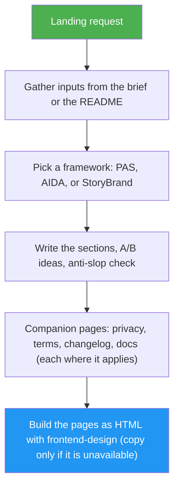

<!--
  DO NOT READ THIS FILE — This README.md is for human catalog browsing only.
  It ships inside the .skill package but is NEVER auto-loaded into agent context.
  The runtime loader only reads SKILL.md + references/ + scripts/ + agents/ when the skill triggers.
  If you're an AI agent, read the SKILL.md file instead for skill instructions.
-->

# Landing Page Generator

> Generate conversion-focused landing page copy (PAS, AIDA, StoryBrand) from a product brief or
> from a project README read as the brief. Every full landing page ships with its companion pages:
> Privacy Policy, Terms of Use, Changelog, and Docs, each where it applies. The last step builds
> the landing page and its companion pages as HTML with `frontend-design`.

## Highlights

- Proven copywriting frameworks: PAS, AIDA, and StoryBrand
- A brief or a README as input: a project's `README.md` can be the brief, read only and never edited (README rewrites belong to `readme-generator`)
- Complete page sections: framework-specific narrative blocks, how it works, social proof, FAQ, and closing CTA
- An FAQ built from the real customer questions you supply (a Search Console query export, support tickets, sales-call notes), close to their words with personal data removed, one entry per question, each answer opening with the direct answer
- Companion pages with every full landing page: Privacy Policy always, Terms of Use for accounts or paid plans, Changelog always, Docs for CLIs, libraries, and products with setup steps, and an About page (who makes it, what it does, for whom) when you ask for one or the brief names the maker, with every fact traced to the brief or a project file and every gap marked, never invented
- A built page at the end of every full run: `frontend-design` turns the copy into `landing-page/index.html` plus one HTML file per companion page, keeping every section, CTA, and `[proof needed]` marker verbatim. Without `frontend-design`, the run delivers the copy, says why no page was built, and reports PARTIAL
- Anti-slop rules to avoid generic AI marketing filler, plus a copy test (every line visualizable, falsifiable, and something only you can say) and hero rules: proof of work, the problem, a contrarian take, and one real number or `[proof needed]`. The launch story from a `product-launch` kit (`launch-kit/copy-bank.md`) is reused when it exists
- Default quality bar: professional, production-ready, elegant, and premium output without being asked
- A/B test ideas and conversion optimization notes with every copy deliverable
- Step Completion Reports per step and a closing Final Report (`Result` / `Evidence` / `Uncertainty` / `Decision`) with a COMPLETE / PARTIAL / BLOCKED status for every run, stops included

## When to Use

| Say this... | Skill will... |
|---|---|
| "Write landing page copy for my SaaS" | Generate full page copy using the best-fit framework |
| "Create sales page content using PAS" | Structure copy around Problem-Agitate-Solution |
| "Generate hero section copy" | Produce headline, subheadline, CTA, and trust bar |
| "Turn my README into a landing page" | Read the README as the brief, write the landing copy, and build the pages; `README.md` stays unchanged |
| "Write the landing page, privacy policy, and changelog for my CLI" | Landing copy plus Privacy Policy, Changelog, and Docs pages |
| "Write a privacy policy page for my landing site" | **One companion page**: only the Privacy Policy, from the brief |
| "Write landing page copy only, I'll build the page myself" | **Copy only**: the copy and companion pages, no HTML build (the skip is recorded) |

To rewrite the `README.md` file itself, use `readme-generator`.

## How It Works



## Usage

```
/landing-page-generator
```

## Resources

| Path | Description |
|---|---|
| `references/section-templates.md` | Output format for all landing page sections, hero rules, the expected output example |
| `references/anti-slop-rules.md` | Banned phrases, structural patterns and the three-part copy test |
| `references/step-reports.md` | Step-completion report format |
| `references/companion-pages.md` | Companion pages: sources, delivery, templates, and checks |
| `references/page-build.md` | Page build: build decision, output folder, `frontend-design` brief, copy-only fallback, page checks |
| `references/final-report.md` | Closing Final Report: status rule, PARTIAL/BLOCKED examples, fill rules, reader checks |

## Output

- Structured landing page copy delivered in chat (hero through final CTA) plus A/B test ideas and
  conversion tips, then a COMPANION PAGES block and the copy of each companion page that applies.
- The pages built as HTML in `landing-page/` (`index.html`, `privacy.html`, `terms.html`,
  `changelog.html`, `docs.html`, each where it applies), unless the user asks for copy only.
- A compact Final Report: `Result` (COMPLETE / PARTIAL / BLOCKED) first, then `Evidence`,
  `Uncertainty`, and `Decision`.
