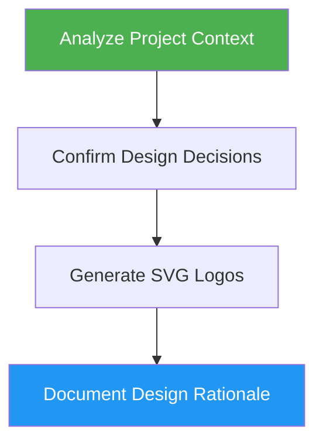

<!--
  DO NOT READ THIS FILE — This README.md is for human catalog browsing only.
  It ships inside the .skill package but is NEVER auto-loaded into agent context.
  The runtime loader only reads SKILL.md + references/ + scripts/ + agents/ when the skill triggers.
  If you're an AI agent, read the SKILL.md file instead for skill instructions.
-->

# Logo Designer

> Design professional, modern logos with automatic project context detection and multiple SVG deliverables.

Version: **1.10.0** · Author: Luong NGUYEN · License: MIT

## Highlights

- Analyze project type (CLI, SaaS, Startup, Enterprise, Consumer) for the starting design decisions
- Confirm concrete decisions, not adjectives: the mark's idea, mark type, construction, stroke, corner radius, layer and colour count, wordmark weight and casing
- Apply design principles: simplicity, scalability, memorability, versatility
- Generate 7 SVG variants (full, mark, wordmark, icon, favicon, white, black), with the wordmark outlined so nothing depends on an installed font
- Export a PNG of every variant (icon 512/1024, mark 512, full/white/black 4W×288 with W the fitted lockup width, wordmark 720×160, favicon 16/32/48) with `rsvg-convert`, `magick`, `inkscape` or headless Chrome
- Render and inspect before shipping: the canonical mark at 16/32/64/512 px before any variant is derived (layers that change neither the 64 nor the 16 px render are cut), the favicon at 16/32/48 px on light and dark tab colors with 1-unit gaps and its own tile when it needs one, and every PNG plus the showcase at 1440 and 390 px against the ban list before `COMPLETE`
- No AI-default effects: no filter, glow, shadow or gradient in any SVG, depth from layer geometry in the fewest layers that carry the idea, and a showcase page with flat cards, sentence-case headings and no remote font
- Read a project design-rules or brand file (`DESIGN.md`, `design-rules.md`, `brand_kit.md` and the like) into the brief's bans; new rule lines are only proposed
- Provide color specs with hex codes and Tailwind config

## When to Use

| Say this... | Skill will... |
|---|---|
| "Create a logo" | Design logo based on project analysis |
| "Design a logo for X" | Generate brand identity with SVG files |
| "Make a favicon" | Create icon and favicon variants |
| "Generate brand identity" | Full logo suite with color specs |

## How It Works



## Installation

Install via [npx (Vercel)](https://www.npmjs.com/package/skills):

```bash
npx skills@1.7.0 add https://github.com/luongnv89/skills --skill logo-designer
```

Or via [agent-skill-manager (asm)](https://www.npmjs.com/package/agent-skill-manager):

```bash
asm install github:luongnv89/skills:extras/logo-designer
```

## Usage

```
/logo-designer
```

## Resources

| Path | Description |
|---|---|
| `agents/brand-researcher.md` | Read project files to produce structured brand brief |
| `agents/svg-generator.md` | Generate all 7 SVG logo files (full, mark, wordmark, icon, favicon, white, black) |
| `agents/svg-reviewer.md` | Validate SVG structure, completeness, and compatibility |
| `references/png-export.md` | Rasterizer detection, per-tool PNG commands, sizes, and the dimension check |
| `references/wordmark-outlining.md` | Licence check, static weight, fontTools outlining, spacing, weight matching, and one set of glyph paths reused in every wordmark file |

## Output

- 7 SVG files in `/assets/logo/` (full, mark, wordmark, icon, favicon, white, black)
- PNG exports in `/assets/logo/png/`, linked from `brand-showcase.html`; with no rasterizer installed the run ends `PARTIAL` and names the install command
- Design rationale document with color specifications
- Brand kit suggestions with Tailwind config
- A closing Final Report that opens with `Result: COMPLETE | PARTIAL | BLOCKED`, then Evidence, Uncertainty and Decision

## Example

[`examples/logo-designer`](https://github.com/luongnv89/skills/tree/main/examples/logo-designer) walks through a complete real run: the Agent Skills logo in this repository. It includes the brief, the project analysis, 26 concept sketches with test renders, the concept board the user chose from, the decisions, the final files, and the validation report.
