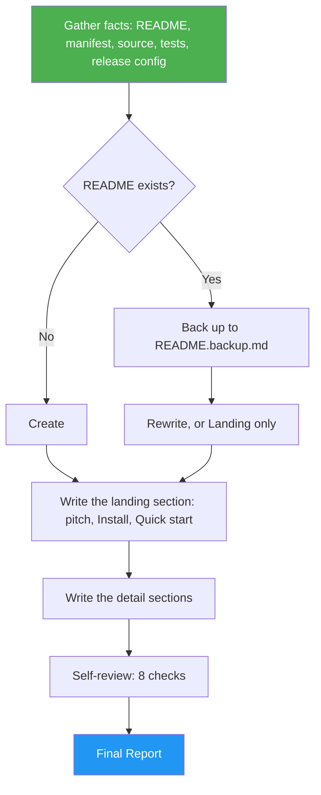

<!--
  DO NOT READ THIS FILE — This README.md is for human catalog browsing only.
  It ships inside the .skill package but is NEVER auto-loaded into agent context.
  The runtime loader only reads SKILL.md + references/ + scripts/ + agents/ when the skill triggers.
  If you're an AI agent, read the SKILL.md file instead for skill instructions.
-->

# README Generator

> Write or rewrite a project's README so a new user can install it and run the most common task from the first screen, with every explanation after that.

## Installation

Install via [npx (Vercel)](https://www.npmjs.com/package/skills):

```bash
npx skills@1.7.0 add https://github.com/luongnv89/skills --skill readme-generator
```

Or via [agent-skill-manager (asm)](https://www.npmjs.com/package/agent-skill-manager):

```bash
asm install github:luongnv89/skills:skills/readme-generator
```

## Usage

Run it in the project whose README you want written or rewritten:

```
/readme-generator
```

The new `README.md` opens like this, and everything else follows:

```markdown
# csvq

Run SQL queries against CSV files from your terminal, with no database to set up.

## Install

go install github.com/acme/csvq@latest

## Quick start

csvq "select id, total from orders.csv order by total desc limit 5"
```

## Highlights

- **Onboarding first, every time:** name and one-line pitch, then Install (one command), then Quick start (the most common task and its output). Diagrams, features, options, and FAQ come after
- **Three modes:** Create a README from project files, Rewrite an existing one, or fix the opening only and leave the rest byte-identical
- **Nothing invented:** every command, flag, and output traces to a project file (`path:line`); a missing fact gets a `[placeholder]` marker, and no project code is run
- **Nothing lost:** the original is backed up to `README.backup.md`, and every original section is mapped to a new section or kept in a `<details>` block
- **Checkable:** an 8-check self-review (landing order, length, sources, links, anti-slop) and a Final Report with `Result` / `Evidence` / `Uncertainty` / `Decision`

## When to Use

| Say this... | Skill will... |
|---|---|
| "Write a README for this repo" | **Create**: build the README from the manifest, source, tests, and release config |
| "Rewrite my README so people can get started fast" | **Rewrite**: back up, restructure landing-first, keep every original fact |
| "Just fix the top of my README, the rest is fine" | **Landing only**: rewrite the opening, leave every later section unchanged |
| "Make my README sell the project" | **Rewrite**: a benefit-led pitch and features, still install-first |

It does not build HTML landing pages, keep docs in sync with code, or add LICENSE and CONTRIBUTING files.

## How It Works



## Resources

| Path | Description |
|---|---|
| `references/landing-section.md` | The landing template, the variant per project type, and the sources for the install command, the common task, and its output |
| `references/section-templates.md` | The detail sections after the landing section, in order |
| `references/anti-slop-rules.md` | Banned phrases, structural slop, and the three-part copy test |
| `references/step-reports.md` | The step completion report format and per-step checks |
| `references/final-report.md` | The Final Report status rules, examples, and reader checks |

## Output

- `README.md`, written or rewritten landing-first
- `README.backup.md` (or a timestamped backup) when a README existed
- A Final Report: `Result` (COMPLETE / PARTIAL / BLOCKED), `Evidence`, `Uncertainty`, `Decision`

No other file changes, and nothing is committed unless you ask.
