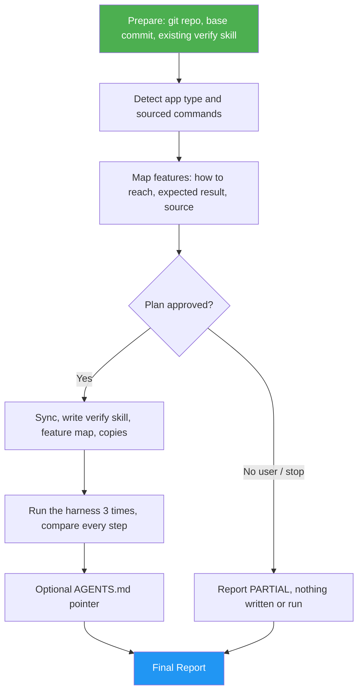

<!--
  DO NOT READ THIS FILE — This README.md is for human catalog browsing only.
  It ships inside the .skill package but is NEVER auto-loaded into agent context.
  The runtime loader only reads SKILL.md + references/ + scripts/ + agents/ when the skill triggers.
  If you're an AI agent, read the SKILL.md file instead for skill instructions.
-->

# Verify Setup

> Write your repo's own verify skill: how to boot your web app, API or CLI, drive each feature, and grade it against a feature map. Agents run it before every commit. The harness is run three times on setup, and any step that changes between runs is reported as flaky.

## Installation

Install via [npx (Vercel)](https://www.npmjs.com/package/skills):

```bash
npx skills@1.7.0 add https://github.com/luongnv89/skills --skill verify-setup
```

Or via [agent-skill-manager (asm)](https://www.npmjs.com/package/agent-skill-manager):

```bash
asm install github:luongnv89/skills:skills/verify-setup
```

## Usage

Run it at the root of the repository:

```
/verify-setup
```

It reads the repo, drafts the verify skill and its feature map, and stops at one plan for you to approve:

```text
◆ verify-setup plan for notepad at 3f2a9c1
App: web app · root: . · verify skill: verify
Sync (after approval):
  S1 git pull --rebase origin main
Write:
  W1 .claude/skills/verify/SKILL.md (new)
  W2 .claude/skills/verify/feature-map.md (new, 6 features)
  W3 .agents/skills/verify/SKILL.md and feature-map.md (identical copies)
  W4 .verify/.gitignore (holds *)
Run (3 times):
  R1 npm start                         package.json:7   port 4173
  R2 curl -fsS localhost:4173/health   server.js:9
  Harness (covered by this approval): mkdir, setsid or set -m, curl, kill, lsof/ss, git rev-parse/git status
Install (each default No):
  I1 npx playwright install chromium — without it F3, F4 stay UNVERIFIED
Pointer:
  P1 AGENTS.md +1 line: "- Before committing, follow `.agents/skills/verify/SKILL.md`"
Reply: approve all · approve <IDs> · change … · stop
```

After you approve, the generated verify skill ends every run with one line other tools can read. Here I1 was declined, so the two browser rows stay unverified:

```text
VERIFY PARTIAL commit=3f2a9c1 dirty=no pass=4 fail=0 unverified=2 total=6 seconds=3
F3 UNVERIFIED: no driver (Add button needs a browser)
F4 UNVERIFIED: no driver (/ shortcut needs a browser)
```

## Highlights

- **Commands from the repo, never guessed:** every install, build, boot and ready command cites the file and line it came from. A command with no source is asked about or left `UNVERIFIED`
- **A feature map as the rubric:** each feature with how to reach it (URL and selector or shortcut, endpoint, or command), the action, the expected result and its source. Expected results come from the repo, never from what the app happens to print
- **Stress-tested on setup:** the harness runs three times from boot to teardown, and every step whose result changed is reported with all three results. Flakes are fixed with real ready signals and fresh state, never with retries or sleeps
- **Nothing without your yes:** files, commands, dependency installs and browser drivers or simulators each appear in the plan first; installs default to No
- **Stays in the repo:** caches, logs and temp files go to a self-ignoring `.verify/` folder. A command that would write outside the repo is not run
- **Two copies:** `.claude/skills/verify/` for Claude Code and an identical `.agents/skills/verify/` for other agents, plus an optional one-line AGENTS.md pointer

## When to Use

| Say this... | Skill will... |
|---|---|
| "Set up a verify skill for this repo" | Detect the app, draft the verify skill and feature map, and stress-test them after you approve |
| "Write a feature map we can grade the app against" | The same, with the feature map as the main output |
| "Our verify skill is flaky, stress-test it" | Run the existing verify skill three times and report the steps that changed |

Not for: unit tests (`test-coverage`), testing the app once as a user and fixing what breaks (`user-test`), pre-commit hooks and CI (`devops-pipeline`). Related: [#435](https://github.com/luongnv89/skills/issues/435) proposes agent-qa regression runs, which a verify skill can call as one step.

## How It Works



## Resources

| Path | Description |
|---|---|
| `references/detection.md` | App types, where commands come from, CLI entry points, keeping writes in the repo, drivers, reuse of devops-pipeline's CLI smoke script |
| `references/feature-map.md` | The feature map format, columns, sources, mutating rows and size |
| `references/verify-skill-template.md` | The generated verify skill and its fixed result line |
| `references/stress-test.md` | The three-run comparison, flaky-step verdicts, fixes to propose, speed |
| `references/final-report.md` | The plan format, step reports and the Final Report |

## Output

- `.claude/skills/verify/SKILL.md` and `feature-map.md` (or `verify-<app>` per app in a monorepo), and identical copies in `.agents/skills/verify/`
- `.verify/` with its own `.gitignore`, holding run logs, caches and temp files
- A stress-test table of three runs, and a Final Report: `Result` (COMPLETE / PARTIAL / BLOCKED), `Evidence`, `Uncertainty`, `Decision`
- Nothing committed or pushed unless you ask
