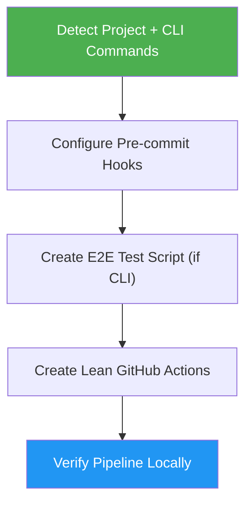

<!--
  DO NOT READ THIS FILE — This README.md is for human catalog browsing only.
  It ships inside the .skill package but is NEVER auto-loaded into agent context.
  The runtime loader only reads SKILL.md + references/ + scripts/ + agents/ when the skill triggers.
  If you're an AI agent, read the SKILL.md file instead for skill instructions.
-->

# DevOps Pipeline

> Set up pre-commit hooks and lean, fast GitHub Actions — maximizing local test coverage to catch issues before they reach CI, and keeping the CI that remains quick for agents that push, wait, and fix, without raising the bill.

## Highlights

- Detect project language and framework automatically
- Configure language-specific linters, formatters, type checkers, and security scanners
- Run unit tests on every commit, full test suite + E2E tests on push
- Enumerate all CLI commands and generate end-to-end smoke tests (for CLI tools)
- Keep GitHub Actions lean — a diff-scoped bypass guard, matrix version testing, secrets-dependent work, and deploys only
- Keep CI fast with free techniques only: caches seeded from the default branch, blobless checkout, superseded-run cancellation, affected-only tests with a default-branch full run, parallel jobs where they are free, everything generated for the repo's visibility, and job timeouts
- Use the fastest free tools: Oxlint for JS/TS linting, TypeScript 7's `tsc` (benchmark `bun check`, `tsrs`), Vitest `isolate: false` with a per-file reset hook
- Audit an existing pipeline's speed from real runs: queue wait, setup, and work per job, cache scope, and the slowest job

## When to Use

| Say this... | Skill will... |
|---|---|
| "Setup CI/CD" | Create full pipeline with pre-commit hooks and lean GitHub Actions |
| "Add pre-commit hooks" | Install and configure local quality gates with push-stage tests |
| "Reduce GitHub Actions dependency" | Shift tests left into pre-commit, slim down CI |
| "Add E2E tests for my CLI" | Enumerate commands and generate `scripts/e2e_test.sh` |
| "Why is our CI so slow?" | Run the read-only CI speed audit and propose free fixes |
| "Make CI faster for our coding agents" | Apply the free speed techniques; never paid or larger runners |

## How It Works



## What Runs Where

| Check | Pre-commit commit | Pre-commit push | GitHub Actions |
|-------|:-----------------:|:---------------:|:--------------:|
| Format / lint / type check | ✓ | — | — |
| Unit tests (fast) | ✓ | — | — |
| Tests the push affects (whole suite when it fits) | — | ✓ | ✓ (PR guard, affected only) |
| Full test suite + version matrix | — | — | ✓ (per merge, or nightly on a busy private repo; coverage upload on public repos) |
| CLI end-to-end tests | — | ✓ | — |
| Bypass guard (both hook stages, PR diff only) | — | — | ✓ |
| Cache seeding from the default branch | — | — | ✓ |
| Deploy | — | — | ✓ |

## Usage

```
/devops-pipeline
```

## Resources

| Path | Description |
|---|---|
| `references/precommit-configs.md` | Language-specific pre-commit configs, fast linters and type checkers, affected tests, Vitest/pytest speedups |
| `references/github-actions.md` | Lean, fast CI workflow templates, the free speed techniques, the CI speed audit, and sources |
| `references/cli-e2e.md` | CLI command discovery, the E2E script template, and its `pre-push` hook |
| `references/final-report.md` | Final report parts, status rules (`COMPLETE`, `PARTIAL`, `BLOCKED`), examples, and reader checks |
| `evals/evals.json` | Trigger and behavior test prompts with expectations |

## Output

- `.pre-commit-config.yaml` with `pre-commit`-stage and `pre-push`-stage hooks
- `scripts/e2e_test.sh` or `tests/e2e/test_cli.py` (for CLI tools)
- `.github/workflows/ci.yml` — lean, fast CI: a diff-scoped bypass guard, default-branch matrix testing, secrets-dependent work, and deploys, with cache seeding, concurrency, and timeouts
- `scripts/affected-tests.sh` (when the suite exceeds the push budget)
- For an audit-only run: the per-job queue/setup/work split and a table of free fixes, with no file written
- Configured and verified local pre-commit environment (both commit and push hooks)
- A final report: `Result:` (`COMPLETE`, `PARTIAL` or `BLOCKED`), `Evidence:` with the commands that ran and their exit codes, `Uncertainty:` (always the CI workflow that has not run yet), and `Decision:` (the approval needed, or `No approval needed.`)
