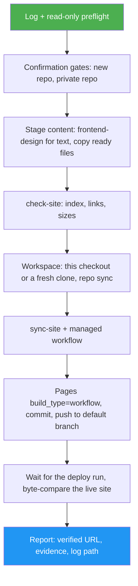

<!--
  DO NOT READ THIS FILE — This README.md is for human catalog browsing only.
  It ships inside the .skill package but is NEVER auto-loaded into agent context.
  The runtime loader only reads SKILL.md + references/ + scripts/ + agents/ when the skill triggers.
  If you're an AI agent, read the SKILL.md file instead for skill instructions.
-->

# GitHub Pages Publish

> Publish or update a static website on GitHub Pages via GitHub Actions, in this repo or any other, and get back a URL that was checked live.

Version: **1.0.0** · Author: Luong NGUYEN · License: MIT

## Highlights

- Takes text (inline, `.md`, `.txt`) or ready HTML (one file or a folder). Text becomes a page through `frontend-design`, keeping your words verbatim
- Publishes to any repo you name, not only the one you are in. It asks before creating a new repo, and before publishing from a private one (Pages sites are always public)
- Creates or repairs one managed deploy workflow (`checkout` → `configure-pages` → `upload-pages-artifact` → `deploy-pages`), resolving the latest action versions at run time, and sets Pages to deploy from GitHub Actions
- Replaces the site folder's content on update and logs every deleted file. A manifest (`.github/pages-publish.json`) records what was published, so a repo root is never swept blindly
- Fixes root-absolute links (`/css/x.css`) that break on project sites served under `/<repo>/`, and catches broken local links before pushing
- Commits only the paths it changed, so your other work in the same checkout stays out of the commit
- Reports the URL only after the live site serves the committed files byte for byte (cache-busted), and logs every step to `.pages-publish/run-<UTC>.md`

## When to Use

| Say this... | Skill will... |
| --- | --- |
| "Publish ./site to GitHub Pages" | Use this repo, put the site in `docs/` or reuse the existing Pages folder, deploy, verify, return the URL |
| "Put these release notes online in a new repo called acme-notes, create it" | Build a page from the text, create the public repo, deploy, verify |
| "Update the website in octo/tea-club with this folder" | Replace the old pages, log deletions, redeploy, verify the new content is live |
| "Dry run: what would you do to publish this to my blog repo?" | Plan everything and show the changes; create and push nothing |

Not for CI test pipelines (`devops-pipeline`), release tagging (`ship`), page design without publishing (`frontend-design`), or hosting outside GitHub Pages.

## How It Works



## Usage

```
/github-pages-publish
```

Requires `git`, an authenticated `gh` (with the `repo` scope, and `workflow` when the workflow file changes), and `python3`. `asm` is optional; it resolves `frontend-design` for text input.

## Resources

| Path | Description |
| --- | --- |
| `scripts/pages_publish.py` | Subcommands `log-init`, `log`, `preflight`, `check-site`, `sync-site`, `workflow`, `configure`, `verify`; standard library only |
| `assets/pages-workflow.yml` | The managed GitHub Actions deploy workflow template |
| `assets/text-page.html` | Fallback page shell for text when `frontend-design` is unavailable |
| `references/content-prep.md` | Text brief, ready-file rules, check-site error handling |
| `references/troubleshooting.md` | Symptom → cause → fix for pushes, Pages settings, runs and the live check |

## Output

A commit on the target repo's default branch (site files, the workflow, and the publish manifest), GitHub Pages set to deploy from Actions, a final report that opens with `Result: PUBLISHED` and the live-checked URL plus evidence (commit, run, matched files), and a run log in `.pages-publish/`. If something fails, the report says PARTIAL or BLOCKED, names the step, and says what to do next.
