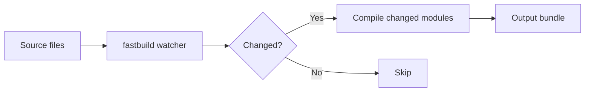

# Mode B — README Landing Page

Transform a project's existing `README.md` into a concise, visual, developer-friendly
landing page. Use this mode when the source material is a repository README (not an open
product brief) and the deliverable is a rewritten `README.md` file in the repo, plus the
companion page files its footer links to (Step 7).

> For marketing landing-page **copy** from a product brief, use Mode A in `SKILL.md` instead.

## Core Principle: Show, Don't Tell

Developers skim — they don't read walls of text. The output README must:

- **Prefer visuals over prose** — use mermaid diagrams for architecture, workflows, data flow
- **Be concise** — every sentence must earn its place; cut ruthlessly
- **Be scannable** — badges, tables, code blocks, diagrams; minimize paragraphs
- **Be direct** — lead with what matters, skip the preamble
- **No emoji** — never use emoji in headings, body text, badges, or section labels

If something can be a diagram, make it a diagram. If something can be a table, make it a table.
If something can be a one-liner, don't write three sentences.

## Anti-Slop Rules

AI-generated READMEs have predictable tells. Slop signals "nobody reviewed this" and kills
credibility. See `references/anti-slop-rules.md` for the full banned-phrase list and structural
patterns to avoid.

**Quick test:** read each sentence and ask "does this give the reader information they didn't
already have?" If not, cut it.

## Repo Sync Before Edits (mandatory)

This mode rewrites a tracked file and adds companion files, so sync with remote first. Follow the `## Repo Sync
Before Edits (mandatory)` section in `SKILL.md` (stash-first pattern); if `origin` is
missing or a conflict occurs, stop and ask the user.

## Workflow

If no `README.md` exists, or the existing one is already marketing-style, see **Edge Cases**
below before starting Step 1 — a different mode applies.

### Step 1: Gather Context

Read project files to build a picture:

| File | Purpose |
|---|---|
| `README.md` | Source material (required) |
| `package.json` / `pyproject.toml` / `Cargo.toml` / `go.mod` | Name, description, version |
| `CHANGELOG.md` | Momentum signals; the Changelog page when it exists |
| `LICENSE` | Risk reversal ("MIT licensed") |
| `docs/` | Existing detailed docs to preserve |
| Existing privacy, terms, or setup pages | Companion pages to link, not rewrite (`references/companion-pages.md` → *Delivery*) |
| Source, manifests, lockfiles, `.env.example` | Docs facts and privacy evidence (`references/companion-pages.md` → *Sources and gap markers*) |

Also check: GitHub stars, forks, download stats, notable users. If purpose or audience is unclear, ask.

### Step 2: Identify Audience & Value Prop

Determine these three things — write them down before proceeding:

1. **Who** — primary audience (developers, data scientists, ops teams, etc.)
2. **Pain** — what's frustrating about the status quo
3. **Benefit** — one sentence, becomes the H1 headline

### Step 3: Select Framework

| Project Type | Framework | Approach |
|---|---|---|
| CLI tools, libraries, infra | **PAS** | Problem -> Agitate -> Solution |
| Apps, platforms, end-user products | **AIDA** | Attention -> Interest -> Desire -> Action |
| Strong narrative / user request | **StoryBrand** | Hero -> Guide -> Plan -> CTA |

Tell the user which you picked. Let them override.

### Step 4: Back Up Original

If `README.backup.md` does not exist, back up to it:

```bash
cp README.md README.backup.md
```

If it exists, keep it and back up to `README.backup.<YYYYMMDD-HHMMSS>.md` instead. Never overwrite a backup.

### Step 5: Rewrite README.md

Follow the section flow in `references/readme-section-templates.md` (hero, how it works, features,
quick start, examples, comparison, social proof, FAQ, CTA, collapsed technical details). Each
template includes good vs. bad patterns and exact length budgets.

Key rules across all sections:
- H1 = value proposition (<=10 words), not the project name
- Hero <=5 lines (excluding badges)
- Each feature description <=15 words
- One copy-paste-runnable command per code block
- Quick Start <=5 steps
- All original technical content preserved in `<details>` blocks
- The final CTA line links each companion page that will exist: run Step 7 items 1-2 first to decide them

### Step 6: Self-Review Checklist

Before presenting to the user, verify:

| Check | Rule |
|---|---|
| Code blocks | Each independently-runnable command is in its own block |
| Mermaid diagrams | >=1 diagram showing how the project works |
| Hero length | <=5 lines (excluding badges) |
| Feature descriptions | <=15 words each |
| Quick Start | <=5 commands |
| Paragraphs | No paragraph exceeds 3 sentences |
| Total prose | Diagrams + tables + code >= 50% of content |
| Original content | All preserved in `<details>` blocks |
| Fabricated data | None — real numbers or placeholders only |
| No emoji | Zero emoji anywhere in the output |
| No slop phrases | None of the banned phrases from `references/anti-slop-rules.md` |
| No filler | Every sentence adds information the reader didn't have |
| No rhetorical questions | No "Tired of X?" or "Want to Y?" patterns |

If any check fails, fix it before presenting.

### Step 7: Write Companion Pages

`SKILL.md` → *Companion Pages* decides which pages apply. `references/companion-pages.md` holds
the sources, the Mode B templates, and the checks.

1. Run the existing-page checks in `references/companion-pages.md` → *Delivery*.
2. Decide each page with this table:

   | The page | Action | Record |
   |---|---|---|
   | Applies and exists | Leave the file unchanged; link it | `linked` |
   | Applies and does not exist | Write it from its template; link it | `written` |
   | Does not apply | Write nothing | `skipped — <reason>` |

3. Run `test -e` on each README link to a companion page. Fix each failing link.
4. Run the companion checks in `references/companion-pages.md`. Fix each failure before presenting.
5. If a fix changed `README.md`, re-run the Step 6 checklist.

### Step 8: Present to User

Briefly explain:
1. Framework chosen
2. Where original content lives (`README.backup.md` + collapsed sections)
3. Each companion page: written, linked, or skipped with its reason

Ask for feedback. Do NOT commit unless asked. Close the run with the Final Report defined
in `SKILL.md` → *Final Report* (`Result:` and its status first, then `Evidence:`,
`Uncertainty:`, `Decision:`).

## Expected Output

For a CLI tool called "fastbuild", the rewritten README.md opens with (outer fence shown as
`~~~` so the inner mermaid block is literal):

~~~markdown


# Incremental builds in under a second

fastbuild watches your source tree and recompiles only changed modules —
no config files, no daemon, no warm-up time.

[**Get Started ->**](#getting-started)

## How It Works



| Feature | What you get |
|---|---|
| Zero config | Works out of the box — no setup files |
| Incremental | Recompiles only changed modules |
| Fast | < 1s on codebases with 10k+ files |
~~~

Original content is preserved in `README.backup.md` and in `<details>` blocks at the end of the new README.

## Edge Cases

- **No README.md found** — Offer to create one from scratch using project manifest files.
- **README is already marketing-style** — Offer targeted section-by-section refinements; preserve what works.
- **Insufficient context for value prop** — Ask the user: what it does, who it's for, what problem it solves.
- **No real social proof** — Skip the section entirely; never fabricate stars, downloads, or testimonials.
- **Highly technical README (API reference)** — Preserve all content in `<details>` blocks; landing-page sections stay brief.
- **Project with no visual output** — Use code-before/after comparisons and terminal snippets instead of screenshots.
- **README longer than 300 lines** — Preserve full original in `README.backup.md`; summarize technical sections as collapsed `<details>` blocks.
- **Companion page already exists** — Link it and leave it unchanged; offer targeted refinements only when the user asks.
- **User asks for one companion file only (for example `PRIVACY.md`)** — Run Repo Sync, then Step 7 for that page only. Leave `README.md` unchanged unless the user asks to link the page.

## Acceptance Criteria

- [ ] Original README backed up to `README.backup.md` before any rewrite
- [ ] Rewritten README uses one of PAS, AIDA, or StoryBrand and names which one was chosen
- [ ] H1 follows the value-proposition rule (see Step 5)
- [ ] Step 6 Self-Review Checklist (13 checks) passes before presenting
- [ ] Rewritten README meets the Default Quality Bar in `SKILL.md` (professional, production-ready, elegant, premium) without the user asking
- [ ] Each companion page is recorded as written, linked, or skipped with its reason; every README link to a companion page passes `test -e`; no existing file other than `README.md` was modified
- [ ] The run closes with the Final Report defined in `SKILL.md` → *Final Report*: `Result:` and its status first, then `Evidence:`, `Uncertainty:`, and `Decision:` lines; `Evidence:` cites only checks that ran
- [ ] The Final Report passes the four reader checks in `references/final-report.md` (result findable, facts and assumptions separated, claims traceable, next decision clear)

## Step Completion Reports

After each major step, output a status report. See `references/readme-step-reports.md` for the
format and phase-specific checks.

## Guidelines

- **One code block per copy-paste unit.** Commands that can run independently must be in separate code blocks. Only combine commands that must run together.
- **Never fabricate data.** Use real numbers or leave `[placeholder]` markers.
- **Respect the project's voice.** A security tool != a startup pitch.
- **H1 follows the value-proposition rule** (see Step 5).
- **Preserve all original content** in collapsed sections.
- **One primary audience.** Don't try to speak to everyone.
- **When in doubt, cut text.** A shorter README that gets read beats a longer one that doesn't.
