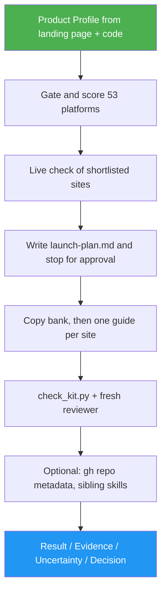

<!--
  DO NOT READ THIS FILE — This README.md is for human catalog browsing only.
  It ships inside the .skill package but is NEVER auto-loaded into agent context.
  The runtime loader only reads SKILL.md + references/ + scripts/ + agents/ when the skill triggers.
  If you're an AI agent, read the SKILL.md file instead for skill instructions.
-->

# Product Launch

> Turn your landing page and codebase into a launch plan across 50 launch sites. Once you approve the plan, it writes the setup guides, posts, pitches and a dated checklist for each site.

## Highlights

- Reads your landing page and, when present, your codebase. It builds a **Product Profile** in which every fact has a source, and nothing is invented.
- Gates and scores **all 50 sites** from a curated list (Product Hunt, Hacker News, Reddit, GeekNews, BetaList, Uneed, DevHunt, AlternativeTo, G2, the AI directories and more) plus your own X, LinkedIn and email list. Each skip gets a reason.
- Re-checks the prices, queues and rules of the shortlisted sites at run time, because launch sites change often.
- **Stops for your approval** before writing anything except the plan.
- Writes a `launch-kit/` folder:
  - a copy bank (taglines and descriptions at every length the sites ask for, plus pitches and FAQ answers);
  - one setup and launch guide per site, with paste-ready fields;
  - an assets checklist;
  - a dated checklist from L-21 to L+30.
- Follows each site's rules:
  - Hacker News bans AI-written text, so you get a brief to write from, not a post.
  - No copy ever asks for votes.
  - Badge-gated free tiers are spelled out.
- `scripts/check_kit.py` checks every field against its site's character limit before you paste anything.

## When to Use

| Say this...                                          | Skill will...                                                                 |
| ---------------------------------------------------- | ----------------------------------------------------------------------------- |
| "Help me launch my product — where should I launch?" | Score all 50 sites against your product and propose a tiered launch plan     |
| "Prepare my Product Hunt launch"                     | Plan just Product Hunt (plus the top 3 other fits), then write its guide      |
| "Write my Show HN post"                              | Explain HN's rule against AI-written posts and give you a founder-voice brief |
| "The launch plan is approved — write the kit"        | Resume from `launch-kit/launch-plan.md` and write every guide and the checklist |

## How It Works



## Installation

Install with [agent-skill-manager (asm)](https://www.npmjs.com/package/agent-skill-manager):

```bash
asm install github:luongnv89/skills:skills/product-launch
```

Optional helpers:

- `gh` sets GitHub topics, description and homepage, after a second yes.
- `/landing-page-generator`, `/logo-designer` and `/seo-ai-optimizer` fill in a missing
  landing page, logo or link-preview tags, only if you opt in.

## Usage

```
/product-launch
```

Give it a landing page URL or file, and run it from the product's repository when there is one. You can name a launch date and a budget. Without them, it proposes a date and plans free paths only, listing paid upgrades as options.

## Resources

| Path                                    | Description                                                                                          |
| --------------------------------------- | ---------------------------------------------------------------------------------------------------- |
| `references/plan-and-reports.md`        | Gates, the 0–10 fit score, tiers and caps, the 53-row platform index, the launch-week scheduling rules, then the plan template, approval question, kit README, step reports and final report |
| `references/platforms-core.md`          | Product Hunt, Hacker News, Reddit (a 19-subreddit rules table), GeekNews, Indie Hackers, Slashdot, Hashnode, GitHub, own channels |
| `references/platforms-launch-boards.md` | 20 launch boards: prices, queues, cadence, field limits, badge rules                                 |
| `references/platforms-directories.md`   | Directories, review sites (G2, Capterra), AI directories, Crunchbase, Wellfound                       |
| `references/product-profile.md`         | The explorer's contract: Profile, Launch blockers and Assets tables                                  |
| `references/launch-kit.md`              | Kit layout, field markers, copy rules, platform-guide and founder-voice templates, writer and reviewer contracts |
| `scripts/check_kit.py`                  | Checks field limits, placeholders, vote requests and founder-voice files (`--self-test` included)    |

The platform facts were verified on 2026-10-22 from each site's own pages. Each run re-checks the sites it shortlists.

## Output

- `launch-kit/launch-plan.md`: the Product Profile, the fit table for every site, the tiered plan, what was skipped and why, the timeline, the budget and the assumptions. It is the only file written before you approve.
- `launch-kit/README.md`: your next 3 actions and a dated checklist.
- `launch-kit/copy-bank.md`: taglines, descriptions, pitches and FAQ answers, each with its length limit.
- `launch-kit/assets.md`: every logo, screenshot and video size each site needs, and what you already have.
- `launch-kit/platforms/<site>.md`: setup steps, paste-ready fields, the post, launch-day steps, the rules that get you removed, and sources.

The run ends with a `Result:` line (COMPLETE, PLAN READY, PARTIAL or BLOCKED), followed by Evidence, Uncertainty and Decision. The skill never posts, signs up, votes or pays for you.
