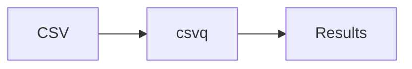

# Landing Section

The opening of every README: name and pitch, Install, Quick start, and optional next links. `SKILL.md` → *The Landing Section* sets the order and the budget. This file gives the template, the variant for each project type, and the source of each line.

## Template

The outer fence is `~~~` so the inner code fences stay literal.

~~~markdown
# <project name>

<optional: one line of badges>

<Pitch: one sentence of 25 words or fewer — what it does, for whom, the outcome.>

## Install

<Optional one-line prerequisite, for example "Requires Node.js 18 or later.">

```bash
<one install command>
```

Other methods: [Homebrew, Docker, from source](#installation-options)

## Quick start

<One sentence naming the most common task.>

```bash
<the command or code for that task>
```

<Expected output: a code block of at most 8 lines, or one sentence describing the result. The landing section stays within 30 non-blank lines.>

[Website](<product website URL>) · [Usage](#usage) · [Configuration](#configuration) · [Changelog](CHANGELOG.md)
~~~

Write the "Other methods" line only when other install methods exist. Write the next-links line only with targets that exist. Put `Website` first on it when a project file names the product website: the manifest's `homepage` (package.json, Cargo.toml, gemspec), `project_urls` or `[project.urls]` (Python), or a website link in the existing README. Copy that URL as written. Never invent or guess one, never use the repository URL as the website, and add no claim about search ranking or SEO. A hosted app already links its site under `## Get started`. Use `## Install` (or `## Get started` for a hosted app) and `## Quick start`, or their equivalents in the README's language. Those are the landing headings that Step 4 accepts. A project installed from a link (app, hosted app, marketplace extension) has the link under the install heading instead of a code block.

## Variant per project type

| Project type | Install | Quick start | Output |
|---|---|---|---|
| CLI | The command that installs the binary: `npm install -g`, `pipx install`, `brew install`, `cargo install`, `go install <module>@latest` | The default command, or the subcommand the docs show most, on input the reader has | Terminal output |
| Library | `npm install`, `pip install`, `cargo add`, `go get`, or the ecosystem's equivalent | The smallest import plus one call that does the library's main job | The printed or returned value |
| Self-hosted service | `docker run` or `docker compose up` from the repo's image or compose file | One request to the running service, for example `curl localhost:<port>/health` | The response |
| Desktop or mobile app | The download, release, or store link | The first action after launch, in one sentence | What the user sees; the repo's own screenshot when one exists |
| GitHub Action, CI or config-only tool | No `## Install`: one workflow or config snippet under `## Quick start` is the install and the first use (the merged snippet) | The snippet | What the run does |
| Editor extension or agent plugin | The marketplace or install command | The first command or prompt | The result |
| Hosted app or website | `## Get started` with the sign-up or open link | The first action | What the user sees |

## Install command

Use the first source that applies:

1. The existing README or docs: the install command they already give.
2. Release config that publishes the package: a CI step that runs `npm publish`, `twine upload`, `pypa/gh-action-pypi-publish`, `cargo publish`, or goreleaser, or a Homebrew formula in the repo. Use that registry's install command with the manifest's package name.
3. From source: the repository URL from `git remote get-url origin` or the manifest's `repository` field, then the manifest's install step, joined with `&&` in one block. Under `Decision:`, ask whether the package is published, and under which name.

Pick one primary method: the one the existing README lists first; otherwise the registry from source 2; otherwise from source. Put every other method in `## Installation options`, and link it in one line under the install command.

Take the prerequisite line from the manifest (`engines`, `requires-python`, `rust-version`, the `go` directive) or from the existing README.

## Most common task

Use the first source that applies:

1. The first usage example in the existing README or the getting-started doc.
2. A CLI's default action, or the subcommand its docs and examples show most often. A library's primary export: the one the package entry exports first, or the one most examples and tests call.
3. An example file or a test that runs the main entry point end to end.

If two candidates tie, ask the user once and list them. Use input the reader can supply: a pipe from their own process, their own file under a generic name (`data.csv`), or a literal string. Never use a path from the author's machine.

## Expected output

- Copy the output from a source: the existing README, docs, a test assertion (`assert add(2, 3) == 5` gives `5`), or an example output file.
- Show at most 8 lines. Cut longer output with a `...` line.
- With no source, write one sentence that describes the result from the code, and list it under `Uncertainty:` as not run.

## Good and bad openings

Good: the reader can install and run it before any explanation.

~~~markdown
# csvq

Run SQL queries against CSV files from your terminal, with no database to set up.

## Install

Requires Go 1.22 or later.

```bash
go install github.com/acme/csvq@latest
```

## Quick start

Show the five largest orders in a CSV file:

```bash
csvq "select id, total from orders.csv order by total desc limit 5"
```

```text
id    total
1042  980.00
1017  912.50
...
```
~~~

Bad: the reader scrolls past a diagram and a feature table to find out how to install.

~~~markdown
# The fastest way to query your data



| Feature | What you get |
|---|---|
| Zero setup | No database needed |

## Installation
...
~~~
