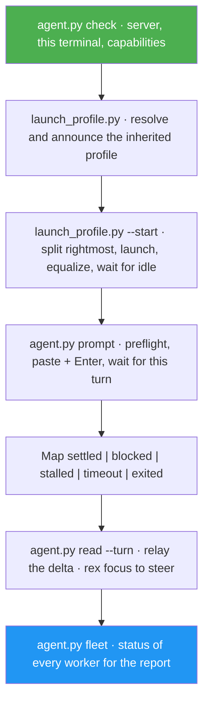

<!--
  DO NOT READ THIS FILE — This README.md is for human catalog browsing only.
  It ships inside the .skill package but is NEVER auto-loaded into agent context.
  The runtime loader only reads SKILL.md + references/ + scripts/ + agents/ when the skill triggers.
  If you're an AI agent, read the SKILL.md file instead for skill instructions.
-->

# Rex Agent

> Manage AI agent fleets in Rex: tile your agent and its workers as equal-width columns in one tab, start them on your own harness and model, prompt, wait for, read, and monitor them through the program status each agent reports, and steer any pane.

## Highlights

- **Root + workers grid** — every column, including yours, lands on exactly 1/N of the window: Rex's split ratios are set in one pass, not by trial and error.
- **One-call spawn** — `launch_profile.py --start` splits the rightmost column, launches the worker through your interactive shell (so rc-file exports reach it), equalizes, and returns only when the worker reports `idle`.
- **Workers mirror the main agent** — same harness, model, thinking level, and setup flags as the agent running the skill, unless you name something else. An inherited permission bypass is announced before any worker starts.
- **Prompt and wait in one call** — `agent.py prompt` refuses busy, blocked, unverifiable, or agent-less targets before typing anything, sends the text as one bracketed paste with a per-turn tag, and waits for the turn it caused; `read --turn` then returns exactly that turn's reply.
- **Status you can trust** — state comes from each agent's own OSC 7501 report, accepted only from the block's current process, so a stale `done` left at a shell prompt never passes for a ready agent.
- **Monitor, broadcast, dispatch, steer** — one fleet table sorted by urgency that tells workers apart from your own panes, one task to many (`broadcast`) or one task each (`dispatch`) with per-target outcomes, and `rex focus` for the pane that needs you.
- **Context handoff** — when the orchestrator's own context passes 50%, it starts a successor, hands over a compact brief, and goes read-only.
- **Built-in `help`** — `/rex-agent help` runs no `rex` command, so it answers even before Rex is installed.

## When to Use

| Say this... | Skill will... |
|---|---|
| "Spin up 2 Rex agents beside me: reviewer and tests" | Add two equal-width columns in your tab, running your own harness, model, and thinking level |
| "Add a codex agent for a second opinion" | Start a Codex worker; your model, effort, and flags are not carried into a different CLI |
| "Ask the reviewer what it found" | Resolve the worker, prompt it, wait for its turn, and relay the reply |
| "Broadcast 'pull main' to all my agents" | Prompt every safe worker concurrently and report each outcome |
| "What are my Rex agents doing?" | One table of every worker's status, blocked first |
| "Keep this fleet going when you run out of context" | Hand the orchestrator role to a fresh `main-g2` column |

## How It Works



## Usage

```
/rex-agent
```

Not sure what to ask for? Start with the built-in summary:

```
/rex-agent help
```

Or describe the goal — "tile a reviewer agent with my pane", "launch a Rex fleet beside me".

## Popular Use Cases

### 1. Root + workers grid (default)

```
/rex-agent spin up 2 agents in a grid with my pane:
- reviewer — review the last commit
- tests — propose a minimal test plan, thinking low
```

### 2. Message a running agent

```
/rex-agent ask reviewer to summarize open risks; show me the reply
```

### 3. Steer live

```
/rex-agent focus the tests agent so I can type into it
```

### 4. Check the fleet

```
/rex-agent what is every fleet agent doing right now?
```

## Resources

| Path | Description |
|---|---|
| `references/` | Layout and spawn recipes, launch-profile inheritance, the per-kind status table and prompt contract, context handoff, the help text, and the final-report format |
| `scripts/` | `agent.py` (check, get, prompt, wait, read, fleet, broadcast, dispatch), `launch_profile.py` (inherited profile and `--start`), `grid.py` (rightmost column and exact equalizing), `rexlib.py` (shared helpers) |
| `tests/` | Unit tests against a fake `rex` built from captured Rex output: `python3 -m unittest discover -s tests` |

## Output

No files. Each fleet operation ends with a step completion report, then a final report: `Result:` first (`COMPLETE`, `PARTIAL` or `BLOCKED`), then `Evidence:` from the commands that ran, `Uncertainty:` (for example an `UNKNOWN` model or an unchecked reply), and `Decision:` naming any approval you need to give. A `help` request prints only the usage summary.

## Requirements

- Rex with the `rex` CLI on PATH (every Rex terminal has it) and a running server (`rex whoami`)
- Run the orchestrator **inside** a Rex terminal, so `REX_SESSION` and `REX_BLOCK` name its block
- Worker CLIs that report OSC 7501 program status: verified with Claude Code 2.1.301, Codex 0.163.0, pi 1.3.0, and Gemini CLI; opencode 2.0.28 reports none
- Optional: `rex skill setup` installs Rex's own guide for everyday Rex tasks; rex-agent does not need it

## Related

- Sibling skills: `herdr-agent` (same workflow for Herdr), `tmux-agent-comms` (plain tmux)
- Rex docs: https://www.superlogical.com/rex/docs
- Program Status Protocol: https://www.superlogical.com/rex/docs/build/program-status
