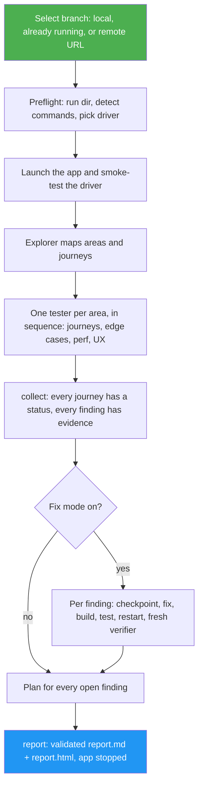

<!--
  DO NOT READ THIS FILE — This README.md is for human catalog browsing only.
  It ships inside the .skill package but is NEVER auto-loaded into agent context.
  The runtime loader only reads SKILL.md + references/ + scripts/ + agents/ when the skill triggers.
  If you're an AI agent, read the SKILL.md file instead for skill instructions.
-->

# User Test

> Launch an app, API or CLI, use every feature the way a real user would, log bugs, slowness and UX problems with evidence, fix the simple and medium ones with a verified rebuild, and get one report with a plan for the rest.

Version: **1.0.1** · Author: Luong NGUYEN · License: MIT

## Highlights

- Starts the app from source (it detects the start, build and test commands for Node, Python, Go, Rust, Rails, Laravel, Java, .NET, Phoenix, Docker Compose and static sites), reuses one that is already running, or tests a deployed URL
- Maps every user-facing feature into areas and journeys, then tests each area as a user: through a browser for web UIs, `curl` for APIs, the shell or `tmux` for CLIs and TUIs. It probes edge cases, a mobile viewport and keyboard-only use
- Watches performance (TTFB, LCP, CLS, click-to-feedback, API and CLI timings against fixed thresholds) and UX, UI and accessibility basics while it tests
- Every finding carries steps to reproduce, expected and actual results, severity with a reason, and evidence files: screenshots, logs or timings
- Fix mode is on by default: simple and medium findings are fixed one at a time behind a per-fix checkpoint, rebuilt and tested against a baseline, then confirmed by a fresh verifier who never sees the diff. A fix that fails twice is rolled back
- Never runs side-effect actions (payments, emails to real people, public posts) without your approval, commits only when you ask, and never touches data, services or processes it did not create
- Writes `report.md` and a filterable `report.html` from one validated `findings.json`, with a plan (approach, effort, risk) for everything still open

## When to Use

| Say this... | Skill will... |
| --- | --- |
| "/user-test my app and fix what you can" | Launch it, test every feature, fix and verify the simple and medium findings, report the rest with a plan |
| "Click through just checkout and search like a customer would" | Test only those features and what is needed to reach them |
| "QA the staging site at https://staging.example.com" | Test the deployed app without fixing anything (no source), report and plan |
| "Dogfood my CLI as a new user, check speed on big files" | Run every command and option, time large inputs under a timeout, fix simple problems |

Not for writing unit tests (`test-coverage`), writing Playwright or Cypress suites, code review without running the app (`code-review`), design-only audits (`design-optimizer`), load testing, or penetration testing.

## How It Works



## Usage

```
/user-test
/user-test focus: checkout, search
/user-test report only
```

Requires `python3` and a way to drive the app: browser automation tools in the session or Playwright for web UIs, `curl` for APIs, a shell (plus `tmux` for full-screen TUIs) for CLIs. Fix mode also needs the source code and a build or test command.

## Resources

| Path | Description |
| --- | --- |
| `scripts/user_test.py` | Subcommands `init`, `doctor`, `detect`, `app start/wait/status/stop`, `check-features`, `collect`, `update`, `build-check`, `checkpoint save/restore/diff`, `report`; standard library only |
| `references/testing.md` | Explorer, tester and verifier instructions: drivers, edge cases, performance thresholds, UX checklist, evidence rules, side effects, the area file schema, severity rubric |
| `references/fixing.md` | Fixer instructions: complexity bounds, what is never auto-fixed, the fix procedure, build and test checks, checkpoints |
| `tests/test_user_test.py` | Unit tests for every subcommand against temp dirs and local processes; no network |

## Tests

```bash
cd skills/user-test
python3 -m unittest discover -s tests -p 'test_*.py' -v
```

## Output

A run dir `.user-test/<UTC stamp>/` in the project (excluded from git) holding `report.md`, `report.html`, `findings.json`, `features.json`, `run.json`, evidence files, logs and per-fix checkpoints. The final response opens with `Result: COMPLETE | PARTIAL | BLOCKED`, then lists evidence, what stayed untested, and the decision left to you: usually reviewing and committing the verified fixes.
